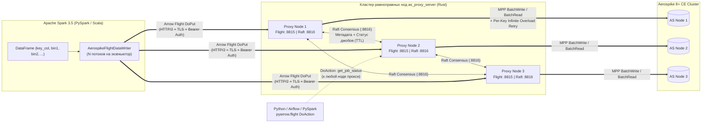

# as-flight-proxy: Spark → Arrow Flight → Rust MPP Proxy → Aerospike 8+ CE

[](https://github.com/1orgar/as-flight-proxy/actions/workflows/ci.yml)
[](https://github.com/1orgar/as-flight-proxy/releases)
[](https://www.rust-lang.org/)
[](https://spark.apache.org/)
[](https://www.scala-lang.org/)
[](https://arrow.apache.org/)
[](https://aerospike.com/)

Высокопроизводительная распределённая система для массово-параллельной записи (MPP) и валидации качества данных (Data Quality / DQ) из **Apache Spark (3.5 / Scala 2.12 / PySpark)** в **Aerospike 8+ Community Edition** через кластер равноправных прокси-нод на **Rust** по протоколу **Apache Arrow Flight (gRPC / HTTP2 + TLS)** с координацией состояния через встроенный **Raft**.

---

## Оглавление

1. [Архитектура и схема работы](#1-архитектура-и-схема-работы)
2. [Маппинг типов данных, семантика `NULL` и `NaN`](#2-маппинг-типов-данных-семантика-null-и-nan)
3. [Режимы работы: запись и DQ-валидация](#3-режимы-работы-запись-и-dq-валидация)
4. [Политика ретраев и контроль перегрузки (Backpressure)](#4-политика-ретраев-и-контроль-перегрузки-backpressure)
5. [Конфигурация `proxy_server` (Rust)](#5-конфигурация-proxy_server-rust)
6. [Опции `spark_connector` (Spark 3.5 / PySpark / Scala)](#6-опции-spark_connector-spark-35--pyspark--scala)
7. [Примеры использования в PySpark и Python (`pyarrow.flight`)](#7-примеры-использования-в-pyspark-и-python-pyarrowflight)
8. [Мониторинг и метрики Prometheus](#8-мониторинг-и-метрики-prometheus)
9. [Сборка, тесты и CI/CD артефакты](#9-сборка-тесты-и-cicd-артефакты)
10. [Roadmap развития проекта](#10-roadmap-развития-проекта)

---

## 1. Архитектура и схема работы



### Ключевые особенности архитектуры:
* **Zero-copy стриминг колоночных батчей**: экзекьюторы Spark конвертируют партиции `InternalRow` напрямую в буферы Apache Arrow `VectorSchemaRoot` и отправляют их параллельно в несколько потоков (`connector.writerThreads`) на узлы прокси (`flight.hosts`).
* **Высокая утилизация ресурсов на прокси (Rust + Tokio)**: каждый входящий `RecordBatch` разбивается на MPP под-батчи и исполняется асинхронно через нативный `Client::batch` (`BatchWrite` для записи и `BatchRead` для DQ-валидации), ограничиваясь глобальным семафором `max_in_flight_records`.
* **Равноправные ноды с Raft-консенсусом на отдельном порту (`:8816`)**:
  * Все прокси-серверы абсолютно симметричны для клиентов Spark.
  * Каждая нода публикует прогресс обработки батчей (`RecordJobBatch`) в Raft. Если нода является Follower-ом, она прозрачно пересылает команду текущему Raft Leader-у.
  * Устаревшая статистика джобов автоматически вычищается из памяти Raft по истечении `raft.job_stats_ttl_secs`.

---

## 2. Маппинг типов данных, семантика `NULL` и `NaN`

### Таблица конвертации типов

| Тип Spark SQL | Тип Apache Arrow | Тип Aerospike (`aerospike::Value`) | Примечание |
| :--- | :--- | :--- | :--- |
| `BooleanType` | `Boolean` | `Value::Bool(bool)` | |
| `ByteType`, `ShortType`, `IntegerType`, `LongType` | `Int8`, `Int16`, `Int32`, `Int64` | `Value::Int(i64)` | Расширяется до 64-битного целого со знаком |
| `FloatType`, `DoubleType` | `Float32`, `Float64` | `Value::Float(FloatValue)` | IEEE-754 64-bit float; в режиме DQ `NaN == NaN` считается **`true`** |
| `DecimalType(p, s)` | `Decimal128(p, s)` | `Value::String(String)` | Строковое представление с точным сохранением масштаба (например, `"123.45"`) |
| `StringType` | `Utf8` / `LargeUtf8` | `Value::String(String)` | UTF-8 строка |
| `BinaryType` | `Binary` / `LargeBinary` | `Value::Blob(Vec<u8>)` | Массив байт |
| `DateType` | `Date32` (days) | `Value::Int(i64)` | **UTC миллисекунды** (`days * 86_400_000`) |
| `TimestampType` | `Timestamp(Microsecond, "UTC")` | `Value::Int(i64)` | **UTC миллисекунды** (`micros / 1_000`) |
| `ArrayType(elemType)` | `List(elemField)` | `Value::List(Vec<Value>)` | Рекурсивная конвертация в Aerospike CDT List |
| `MapType(kType, vType)` | `Map(entries)` | `Value::OrderedMap(IndexMap)` | Рекурсивная конвертация в Aerospike CDT Map |
| `StructType(fields)` | `Struct(fields)` | `Value::OrderedMap(IndexMap)` | Вложенный документ (`field_name -> Value`) |

### Первичный ключ (`aerospike.keyColumn`)
* Поддерживаются типы: `StringType`, целочисленные (`Byte`, `Short`, `Int`, `Long`) и `BinaryType`.
* `NULL` в колонке первичного ключа недопустим: и `spark_connector`, и `proxy_server` немедленно завершают обработку с `InvalidArgument`.

### Поведение при `NULL` в колонках бинов (`aerospike.ignoreNulls`)
* **По умолчанию `aerospike.ignoreNulls = false`**:
  * В режиме **`update` / `update_only`**: `NULL` в колонке порождает `Bin::new(col_name, Value::Nil)`, что **удаляет этот бин** у записи в Aerospike.
  * В режиме **`replace` / `replace_only` / `create_only`**: `NULL`-колонки не включаются в набор бинов (так как `replace` сам перезаписывает запись целиком).
  * В режиме **`validate` / `dq`**: `NULL`-колонка проверяет, что соответствующий бин в Aerospike отсутствует (или равен `Nil`).
* **При `aerospike.ignoreNulls = true`**:
  * `NULL`-значения полностью пропускаются как при записи, так и при DQ-сверке (существующие бины в Aerospike не затрагиваются).

---

## 3. Режимы работы: запись и DQ-валидация

Режим задаётся опцией `aerospike.writeMode` (а также флагом `aerospike.dq = true` для валидации):

| Значение `aerospike.writeMode` | Действие на стороне `proxy_server` |
| :--- | :--- |
| **`update`** *(по умолчанию)* | Обновляет только бины, присутствующие в DataFrame (`RecordExistsAction::Update`). Другие бины записи в Aerospike сохраняются. |
| **`replace`** | Полностью заменяет запись в Aerospike (`RecordExistsAction::Replace`). Все старые бины, которых нет в DataFrame, удаляются. |
| **`update_only`** | Обновляет бины только если ключ уже существует в Aerospike; иначе возвращает ошибку. |
| **`replace_only`** | Заменяет запись целиком только если ключ уже существует в Aerospike. |
| **`create_only`** | Создаёт новую запись только если ключа ещё нет в Aerospike. |
| **`validate`** (или `aerospike.dq = true`) | **Режим проверки записи (Data Quality)**: прокси не модифицирует данные, а читает записи из Aerospike батчами (`BatchRead`) и побиново сравнивает их с данными из Spark. |

### Особенности режима DQ-валидации (`aerospike.dq = true`)
1. **Сравнение `NaN == NaN` даёт `true`**:
   * При сверке чисел с плавающей точкой (`Float32` / `Float64`), если и в Spark, и в Aerospike значение является `NaN` (`fa.is_nan() && fb.is_nan()`), значения считаются **равными** независимо от знакового бита или битового payload IEEE-754.
   * Это правило работает рекурсивно, включая `NaN` внутри вложенных `Array`, `Map` и `Struct`.
2. **Детальная статистика расхождений в Raft**:
   * Считается общее число проверенных строк (`total_rows_validated`), совпавших (`total_matched_rows`), отсутствующих ключей (`total_missing_keys`) и ключей с расхождением значений бинов (`total_bin_mismatch_rows`).
   * Поле `dq_passed` принимает значение `true`, если `total_mismatched_rows == 0`, иначе `false`.
   * В список `dq_mismatch_samples` сохраняется до 20 примеров несовпавших ключей с указанием конкретного бина и ожидаемого/фактического значения.

---

## 4. Политика ретраев и контроль перегрузки (Backpressure)

На стороне `proxy_server` ошибки при обращении к Aerospike делятся на две категории:

1. **Ошибки перегрузки и нехватки ресурсов (ретраятся «до талого» / бесконечно)**:
   * Серверные коды: `DEVICE_OVERLOAD`, `KEY_BUSY`, `XDR_KEY_BUSY`.
   * Клиентские коды и состояния пула: `MAX_RETRIES_EXCEEDED`, `NO_AVAILABLE_CONNECTIONS_TO_NODE` (`NoMoreConnections`), `ConnectionPoolEmpty`, `AsyncQueueFull`.
   * **Частичный ретрай пачки (`Partial Batch Retry`)**: если в `BatchWrite` или `BatchRead` из 512 ключей 500 выполнились с `ResultCode::Ok`, а 12 вернули `KEY_BUSY` или `DEVICE_OVERLOAD`, на следующей попытке переотправляются **только оставшиеся 12 ключей** с экспоненциальным backoff и полным джиттером (`initial_backoff_ms` → `max_backoff_ms`).
2. **Все остальные ошибки (ретраятся до `max_other_retries` раз)**:
   * Например, ошибки сети, таймауты, неверные параметры или отсутствие существующего ключа при `update_only`.
   * После исчерпания `retry.max_other_retries` попыток для конкретного ключа стрим завершается с ошибкой `Status::aborted`, джоб в Raft помечается как `failed`, и Spark-задача корректно падает.

---

## 5. Конфигурация `proxy_server` (Rust)

Пример полного конфигурационного файла (`proxy_server/config.example.toml`):

```toml
[server]
listen_addr = "0.0.0.0:8815"                  # Порт Arrow Flight gRPC сервера
metrics_addr = "0.0.0.0:9090"                 # Порт HTTP сервера для /metrics и /healthz
max_decoding_message_size_mb = 64             # Максимальный размер gRPC сообщения (МБ)
tcp_nodelay = true
http2_stream_window_size_mb = 16
http2_connection_window_size_mb = 32

[raft]
enabled = true
node_id = 1                                   # Уникальный ID ноды в кластере (1, 2, 3, ...)
listen_addr = "0.0.0.0:8816"                  # Отдельный порт для обмена метадатой по Raft
election_timeout_min_ms = 150
election_timeout_max_ms = 300
heartbeat_interval_ms = 50
job_stats_ttl_secs = 3600                     # TTL хранения статистики джобов в Raft (в секундах)

# Список всех равноправных нод кластера прокси:
# [[raft.peers]]
# node_id = 1
# raft_addr = "10.0.0.1:8816"
# flight_addr = "10.0.0.1:8815"
# [[raft.peers]]
# node_id = 2
# raft_addr = "10.0.0.2:8816"
# flight_addr = "10.0.0.2:8815"
# [[raft.peers]]
# node_id = 3
# raft_addr = "10.0.0.3:8816"
# flight_addr = "10.0.0.3:8815"

[tls]
enabled = false
# cert_path = "/etc/as_proxy/server.crt"      # Сертификат сервера (PEM)
# key_path = "/etc/as_proxy/server.key"       # Приватный ключ сервера (PEM)
# client_ca_path = "/etc/as_proxy/ca.crt"     # Опционально: корневой сертификат клиентов для mTLS

[auth]
enabled = true
username = "spark_writer"
password = "change_me_in_prod"
token_secret = "super_secret_hmac_key_for_flight_bearer_tokens"
token_ttl_secs = 86400

[aerospike]
hosts = "127.0.0.1:3000"                      # Seed-узлы кластера Aerospike 8+ CE
connect_timeout_ms = 5000
timeout_ms = 2000
min_conns_per_node = 16
max_conns_per_node = 512
conn_pools_per_node = 4
max_bin_name_len = 64

[writer]
use_batch_write = true                        # Использовать нативный BatchWrite (Client::batch)
batch_write_size = 512                        # Размер одной MPP под-пачки ключей
max_in_flight_records = 16384                 # Глобальный лимит одновременно летящих в Aerospike записей
max_concurrent_subbatches_per_stream = 16     # Параллелизм под-пачек внутри одного стрима DoPut

[retry]
max_other_retries = 5                         # Лимит повторов для не-перегрузочных ошибок
initial_backoff_ms = 10
max_backoff_ms = 2000
backoff_multiplier = 2.0
```

Параметры также можно переопределять через флаги CLI или переменные окружения:
* `--config` / `AS_PROXY_CONFIG`
* `--listen-addr` / `AS_PROXY_LISTEN_ADDR`
* `--raft-addr` / `AS_PROXY_RAFT_ADDR`
* `--node-id` / `AS_PROXY_NODE_ID`
* `--aerospike-hosts` / `AEROSPIKE_HOSTS`

---

## 6. Опции `spark_connector` (Spark 3.5 / PySpark / Scala)

Формат источника данных: `.format("aerospike-flight")`.

| Опция | Обязательна | По умолчанию | Описание |
| :--- | :---: | :---: | :--- |
| `aerospike.namespace` | **Да** | — | Namespace в Aerospike |
| `aerospike.keyColumn` | **Да** | — | Имя колонки DataFrame, содержащей первичный ключ |
| `aerospike.set` | Нет | `""` | Имя Set в Aerospike |
| `aerospike.writeMode` | Нет | `"update"` | Режим: `"update"`, `"replace"`, `"update_only"`, `"replace_only"`, `"create_only"`, `"validate"` (`"dq"`) |
| `aerospike.dq` | Нет | `"false"` | Если `"true"` — включает режим проверки записи (DQ-валидации) |
| `aerospike.ignoreNulls` | Нет | `"false"` | По умолчанию `false` (`null` в `update` удаляет бин в Aerospike). Если `true` — `null`-колонки игнорируются |
| `aerospike.ttl` | Нет | Namespace default | TTL записи в секундах (`-1` = Never expire, `-2` = Do not update TTL) |
| `aerospike.sendKey` | Нет | `"true"` | Сохранять ли исходное значение пользовательского ключа на сервере Aerospike |
| `aerospike.useBatchWrite` | Нет | Настройка прокси | Принудительно включить (`true`) или отключить (`false`) `BatchWrite` для данного джоба |
| `flight.hosts` | Нет | `"127.0.0.1:8815"` | Список адресов прокси-нод через запятую (`"proxy1:8815,proxy2:8815,proxy3:8815"`) |
| `flight.username` | Нет | `""` | Логин для Arrow Flight `Handshake` |
| `flight.password` | Нет | `""` | Пароль для Arrow Flight `Handshake` |
| `flight.tls.enabled` | Нет | `"false"` | Включить TLS при подключении к прокси |
| `flight.tls.caCertPath` | Нет | Системный truststore | Путь к PEM-файлу корневого сертификата CA на узлах Spark |
| `flight.tls.clientCertPath` | Нет | — | Путь к клиентскому сертификату (PEM) для mTLS |
| `flight.tls.clientKeyPath` | Нет | — | Путь к приватному ключу клиента (PKCS#8 PEM) для mTLS |
| `flight.tls.verifyServer` | Нет | `"true"` | Проверять ли сертификат сервера при TLS |
| `flight.timeoutMs` | Нет | `"60000"` | Таймаут RPC вызовов Arrow Flight (мс) |
| `connector.jobId` | Нет | Авто `UUID` | Уникальный идентификатор выгрузки для отслеживания статуса в Raft |
| `connector.batchSize` | Нет | `"8192"` | Число строк в одном Arrow `RecordBatch` |
| `connector.writerThreads` | Нет | `"4"` | Число параллельных потоков отправки Arrow Flight внутри каждой Spark-задачи |
| `connector.queueCapacity` | Нет | `writerThreads * 2` | Размер очереди подготовленных `RecordBatch` внутри задачи |

---

## 7. Примеры использования в PySpark и Python (`pyarrow.flight`)

### Запуск PySpark с Fat-JAR коннектора
```bash
pyspark --jars spark-aerospike-flight-connector-assembly-0.1.0.jar
```

### 7.1. Параллельная запись DataFrame из PySpark в Aerospike
```python
job_id = "user-features-load-2026-11-06"

(
    df.repartition(64, "user_id")
    .write.format("aerospike-flight")
    .option("connector.jobId", job_id)
    .option("flight.hosts", "proxy-1:8815,proxy-2:8815,proxy-3:8815")
    .option("flight.username", "spark_writer")
    .option("flight.password", "change_me_in_prod")
    .option("flight.tls.enabled", "true")
    .option("flight.tls.caCertPath", "/etc/certs/ca.crt")
    .option("aerospike.namespace", "prod_ns")
    .option("aerospike.set", "user_features")
    .option("aerospike.keyColumn", "user_id")
    .option("aerospike.writeMode", "update")      # "update" или "replace"
    .option("aerospike.ignoreNulls", "false")     # null удаляет бин
    .option("aerospike.ttl", "86400")
    .option("connector.batchSize", "8192")
    .option("connector.writerThreads", "4")
    .mode("append")
    .save()
)
```

### 7.2. Запуск проверки записи (Data Quality / DQ) из PySpark
```python
dq_job_id = "user-features-dq-2026-11-06"

(
    df.repartition(64, "user_id")
    .write.format("aerospike-flight")
    .option("connector.jobId", dq_job_id)
    .option("flight.hosts", "proxy-1:8815,proxy-2:8815,proxy-3:8815")
    .option("flight.username", "spark_writer")
    .option("flight.password", "change_me_in_prod")
    .option("flight.tls.enabled", "true")
    .option("flight.tls.caCertPath", "/etc/certs/ca.crt")
    .option("aerospike.namespace", "prod_ns")
    .option("aerospike.set", "user_features")
    .option("aerospike.keyColumn", "user_id")
    .option("aerospike.dq", "true")               # Режим DQ-сверки (NaN == NaN -> True)
    .option("aerospike.ignoreNulls", "false")
    .mode("append")
    .save()
)
```

### 7.3. Получение статуса загрузки и результата DQ в Python через `pyarrow.flight` (с TLS и авторизацией)

Функция ниже подключается к любой ноде прокси по `grpc://` или `grpc+tls://`, проходит `Handshake` (`authenticate_basic_token` → получает подписанный `Bearer` токен) и запрашивает реплицированный в Raft статус джоба через `DoAction`:

```python
import json
from pathlib import Path
import pyarrow.flight as fl


def get_aerospike_job_status(
    host_port: str,
    job_id: str,
    username: str,
    password: str,
    tls_enabled: bool = False,
    ca_cert_path: str | None = None,
    client_cert_path: str | None = None,
    client_key_path: str | None = None,
    verify_server: bool = True,
    timeout_sec: float = 10.0,
) -> dict:
    scheme = "grpc+tls" if tls_enabled else "grpc"
    location = f"{scheme}://{host_port}"

    client_kwargs = {}
    if tls_enabled:
        if ca_cert_path:
            client_kwargs["tls_root_certs"] = Path(ca_cert_path).read_bytes()
        if client_cert_path and client_key_path:
            client_kwargs["cert_chain"] = Path(client_cert_path).read_bytes()
            client_kwargs["private_key"] = Path(client_key_path).read_bytes()
        if not verify_server:
            client_kwargs["disable_server_verification"] = True

    client = fl.FlightClient(location, **client_kwargs)
    try:
        # 1. Handshake -> возвращает кортеж ('authorization', 'Bearer <token>')
        bearer_header = client.authenticate_basic_token(username, password)
        call_options = fl.FlightCallOptions(
            headers=[bearer_header],
            timeout=timeout_sec,
        )

        # 2. Запрос статуса джоба из Raft (доступен на любой ноде прокси в течение job_stats_ttl_secs)
        action = fl.Action("get_job_status", job_id.encode("utf-8"))
        results = client.do_action(action, options=call_options)
        return json.loads(next(results).body.to_pybytes())
    finally:
        client.close()


# Пример проверки результата DQ-джоба:
dq_status = get_aerospike_job_status(
    host_port="proxy-1:8815",
    job_id=dq_job_id,
    username="spark_writer",
    password="change_me_in_prod",
    tls_enabled=True,
    ca_cert_path="/etc/certs/ca.crt",
)

print("State:", dq_status["state"])                          # "running" | "completed" | "failed"
print("DQ Passed:", dq_status["dq_passed"])                  # True | False
print("Rows Validated:", dq_status["total_rows_validated"])
print("Matched Rows:", dq_status["total_matched_rows"])
print("Missing Keys:", dq_status["total_missing_keys"])
print("Bin Mismatches:", dq_status["total_bin_mismatch_rows"])
print("Per Proxy Node:", dq_status["per_node_rows"])
if not dq_status["dq_passed"]:
    for sample in dq_status["dq_mismatch_samples"]:
        print(f"Mismatch on {sample['key']}: {sample['reason']}")
```

---

## 8. Мониторинг и метрики Prometheus

На порту `server.metrics_addr` (по умолчанию `:9090`) доступны только служебные эндпоинты:
* `GET /healthz` — проверка связности прокси с кластером Aerospike (`200 OK` / `503 Service Unavailable`).
* `GET /metrics` — метрики в формате Prometheus:
  * `as_proxy_records_written_total` — общее число записанных в Aerospike записей.
  * `as_proxy_batches_processed_total` — общее число обработанных Arrow `RecordBatch`.
  * `as_proxy_overload_retries_total` — число ретраев перегрузки (`DEVICE_OVERLOAD`, `KEY_BUSY`, `NO_MORE_CONNECTIONS`, `MAX_RETRIES_EXCEEDED`).
  * `as_proxy_other_retries_total` — число прочих ретраев.
  * `as_proxy_failed_records_total` — число записей, завершившихся фатальной ошибкой после исчерпания ретраев.
  * `as_proxy_in_flight_records` — текущее число записей в полёте к Aerospike.
  * `as_proxy_active_streams` — текущее число активных стримов `DoPut`.
  * `as_proxy_write_duration_seconds_sum` / `_count` — суммарное время и количество вызовов под-батчей Aerospike.
  * `as_proxy_aerospike_connected` — статус подключения к Aerospike (`1` / `0`).
  * `as_proxy_raft_term`, `as_proxy_raft_is_leader`, `as_proxy_raft_commit_index` — метрики состояния Raft-узла.

---

## 9. Сборка, тесты и CI/CD артефакты

### Локальная сборка и запуск тестов
```bash
# Rust Proxy Server
cd proxy_server
cargo test
cargo build --release

# Spark Connector (Scala 2.12 / Spark 3.5)
cd ../spark_connector
sbt test
sbt assembly
```

### GitHub Actions CI и релизные артефакты
При каждом пуше в `main` и создании тега `v*` workflow [`.github/workflows/ci.yml`](.github/workflows/ci.yml) автоматически прогоняет тесты и публикует 3 артефакта (а при пуше тега `v*` — прикрепляет их к GitHub Release):
1. `as_proxy_server-linux-x86_64` — бинарник прокси-сервера для Linux `x86_64`.
2. `as_proxy_server-linux-arm64` — бинарник прокси-сервера для Linux `ARM64` (`aarch64`).
3. `spark-aerospike-flight-connector-assembly-0.1.0.jar` — Fat-JAR коннектора для Spark 3.5.

### Запуск полного E2E-стенда (Docker Compose)
В репозитории подготовлен симметричный E2E-стенд ([`docker-compose.e2e.yml`](docker-compose.e2e.yml) и [`e2e/run_e2e_test.py`](e2e/run_e2e_test.py)), поднимающий **2 ноды Aerospike 8.0 CE** в mesh-кластере (`replication-factor 2`), **2 ноды `as_proxy_server`** в Raft-кластере и контейнер **Spark 3.5 PySpark**:

```bash
# 1. Скачать бинарник прокси (x86_64 или arm64) и Fat-JAR коннектора из релиза v0.1.0 в e2e/artifacts/
mkdir -p e2e/artifacts
ARCH=$(uname -m | sed 's/aarch64/arm64/')
curl -sL "https://github.com/1orgar/as-flight-proxy/releases/download/v0.1.0/as_proxy_server-linux-${ARCH}" -o e2e/artifacts/as_proxy_server
chmod +x e2e/artifacts/as_proxy_server
curl -sL "https://github.com/1orgar/as-flight-proxy/releases/download/v0.1.0/spark-aerospike-flight-connector-assembly-0.1.0.jar" -o e2e/artifacts/spark-aerospike-flight-connector-assembly-0.1.0.jar

# 2. Запустить E2E-тест (запись 500 строк + проверка Raft + позитивный и негативный DQ)
docker compose -f docker-compose.e2e.yml up --abort-on-container-exit --exit-code-from spark-e2e
docker compose -f docker-compose.e2e.yml down
```

---

## 10. Roadmap развития проекта

Подробный план на следующие 4 релиза (`v0.2.0` – `v0.5.0`) описан в файле [`ROADMAP.md`](ROADMAP.md):
* **`v0.2.0`** — Параллельное чтение из Aerospike в Spark (`spark.read.format("aerospike-flight")` через `GetFlightInfo` + `DoGet`, Partition Scans, Batch Reads и Predicate Pushdown).
* **`v0.3.0`** — Расширенные операции Aerospike (CDT List/Map merge, атомарные инкременты, пер-строчный TTL из колонки, массовое удаление `delete` и zstd-сжатие Arrow Flight).
* **`v0.4.0`** — Умный раутинг и отказоустойчивость в `spark_connector` (авто-обнаружение живых нод прокси через Raft, динамический failover стрима `DoPut` без перезапуска Spark-таска, Rate Limiter).
* **`v0.5.0`** — Персистентность Raft (WAL + Snapshots на диск), мульти-тенантная авторизация (RBAC по namespace / JWT) и OpenTelemetry трейсинг.
