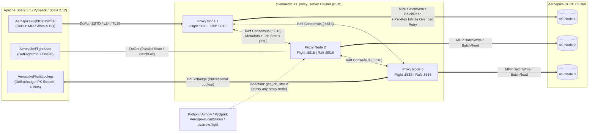

# as-flight-proxy: Spark → Arrow Flight → Rust MPP Proxy → Aerospike 8+ CE

> 🌐 **Language / Язык**: **[🇬🇧 English (README.md)](README.md)** | **[🇷🇺 Русская версия (README.ru.md)](README.ru.md)**

[](https://github.com/1orgar/as-flight-proxy/actions/workflows/ci.yml)
[-86.1%25-brightgreen?logo=rust)](https://github.com/1orgar/as-flight-proxy/actions/workflows/ci.yml)
[-88.2%25-brightgreen?logo=scala)](https://github.com/1orgar/as-flight-proxy/actions/workflows/ci.yml)
[](https://github.com/1orgar/as-flight-proxy/releases)
[](https://www.rust-lang.org/)
[](https://spark.apache.org/)
[](https://www.scala-lang.org/)
[](https://arrow.apache.org/)
[](https://aerospike.com/)

A high-performance distributed system for **massively parallel writing (MPP Write)**, **parallel reading (Scan / BatchGet)**, **streaming primary-key enrichment (`DoExchange` Lookup)**, and **Data Quality (DQ) validation** between **Apache Spark 3.5 (Scala 2.12 / PySpark)** and **Aerospike 8+ Community Edition** via a symmetric cluster of **Rust** proxy servers over **Apache Arrow Flight (gRPC / HTTP2 + TLS + native ZSTD/LZ4 compression)** with built-in **Raft** metadata replication.

---

## 📚 Comprehensive Documentation

Detailed bilingual guides covering architecture, configuration, all parameters, metrics, and production examples are located in [`docs/en/`](docs/en/) and [`docs/ru/`](docs/ru/):

| Documentation Guide (EN) | Русская версия (RU) | Contents |
| :--- | :--- | :--- |
| **[1. Architecture & Internals](docs/en/architecture.md)** | **[Архитектура и устройство](docs/ru/architecture.md)** | Arrow Flight RPC flows (`DoPut`, `DoGet`, `DoExchange`, `GetSchema`, `DoAction`), dual-layer compression (`ZSTD` / `LZ4` / `GZIP`), zero-copy hot-path optimizations, type mapping, Raft, and per-key retry semantics. |
| **[2. Proxy Server Configuration](docs/en/proxy-configuration.md)** | **[Конфигурация `proxy_server`](docs/ru/proxy-configuration.md)** | Full reference for `config.toml`, CLI flags, environment variables, TLS/mTLS setup, Aerospike connection pools, concurrency tuning, and Linux kernel tuning. |
| **[3. Spark Connector Guide & Examples](docs/en/spark-connector.md)** | **[Справочник `spark_connector`](docs/ru/spark-connector.md)** | Complete `.format("aerospike-flight")` options reference, `AerospikeFlightLookup` (Scala + PySpark), `AerospikeLoadStatus`, and examples for Write, DQ, Read, and Python `pyarrow.flight`. |
| **[4. Direct Flight Operations (Python)](docs/en/flight-operations.md)** | **[Прямые вызовы Flight из Python](docs/ru/flight-operations.md)** | Calling Arrow Flight methods directly from Python (`pyarrow.flight`): querying Raft cluster & job status, resetting jobs, reading into `pyarrow.Table` / `pandas`, `DoExchange` lookup, and `DoPut`. |
| **[5. Observability, Metrics & Logging](docs/en/observability.md)** | **[Мониторинг и логи](docs/ru/observability.md)** | Reference for all 21 Prometheus metrics, ready-to-use PromQL queries, Driver & Executor log guides, and troubleshooting playbook. |

---

## Table of Contents

1. [Architecture & Data Flows](#1-architecture--data-flows)
2. [Data Type Mapping, `NULL` & `NaN` Semantics](#2-data-type-mapping-null--nan-semantics)
3. [Operating Modes: Write, DQ, Read & `DoExchange` Lookup](#3-operating-modes-write-dq-read--doexchange-lookup)
4. [Arrow Flight Compression & Performance Optimizations](#4-arrow-flight-compression--performance-optimizations)
5. [Rust `proxy_server` Configuration](#5-rust-proxy_server-configuration)
6. [Spark Connector Options (`aerospike-flight`)](#6-spark-connector-options-aerospike-flight)
7. [Quick-Start Examples (PySpark, Scala, `pyarrow.flight`)](#7-quick-start-examples-pyspark-scala-pyarrowflight)
8. [Monitoring & Prometheus Metrics](#8-monitoring--prometheus-metrics)
9. [Build, Test & CI/CD Release Artifacts (`.zip` & Fat-JAR)](#9-build-test--cicd-release-artifacts-zip--fat-jar)

---

## 1. Architecture & Data Flows



### Key Architectural Highlights
* **Four High-Throughput Data Paths**:
  1. **MPP Write (`DoPut`)**: Parallel streaming of Spark partitions into Aerospike (`update`, `replace`, `update_only`, `replace_only`, `create_only`).
  2. **Data Quality Validation (`DoPut` + `validateOnly`)**: Bin-by-bin comparison of Spark DataFrames against Aerospike records via `BatchRead`, with `NaN == NaN -> true` equivalence and mismatch sampling in Raft.
  3. **Parallel Read (`GetSchema` + `GetFlightInfo` + `DoGet`)**: Direct `BatchGet` by primary keys (`aerospike.read.keys`) or parallel partition scans with **Filter Pushdown** and **Column Pruning**.
  4. **Streaming Primary-Key Enrichment (`DoExchange` Lookup)**: Bidirectional Arrow Flight streaming that sends primary keys from an existing DataFrame partition and streams back only the requested Aerospike bins (`left` or `inner` join) without full-set scans or Spark shuffles.
* **Symmetric Proxy Cluster with Raft Consensus (`:8816`)**:
  * All proxy nodes are identical entry points for Spark executors.
  * Every node replicates batch progress (`RecordJobBatch`) via Raft (`:8816`), making job status and DQ reports queryable from any proxy node via `DoAction("get_job_status")`.

---

## 2. Data Type Mapping, `NULL` & `NaN` Semantics

| Spark SQL Type | Apache Arrow Type | Aerospike Type (`aerospike::Value`) | Notes |
| :--- | :--- | :--- | :--- |
| `BooleanType` | `Boolean` | `Value::Bool(bool)` | |
| `ByteType`, `ShortType`, `IntegerType`, `LongType` | `Int8`, `Int16`, `Int32`, `Int64` | `Value::Int(i64)` | Widened to signed 64-bit integer |
| `FloatType`, `DoubleType` | `Float32`, `Float64` | `Value::Float(FloatValue)` | IEEE-754 64-bit float; in DQ mode `NaN == NaN` evaluates to **`true`** |
| `DecimalType(p, s)` | `Decimal128(p, s)` | `Value::String(String)` | Exact scale-preserving string representation (e.g. `"123.45"`) |
| `StringType` | `Utf8` / `LargeUtf8` | `Value::String(String)` | UTF-8 string |
| `BinaryType` | `Binary` / `LargeBinary` | `Value::Blob(Vec<u8>)` | Raw byte array |
| `DateType` | `Date32` (days) | `Value::Int(i64)` | **UTC milliseconds** (`days * 86_400_000`) |
| `TimestampType` | `Timestamp(Microsecond, "UTC")` | `Value::Int(i64)` | **UTC milliseconds** (`micros / 1_000`) |
| `ArrayType(elemType)` | `List(elemField)` | `Value::List(Vec<Value>)` | Recursive conversion to Aerospike CDT List |
| `MapType(kType, vType)` | `Map(entries)` | `Value::OrderedMap(IndexMap)` | Recursive conversion to Aerospike CDT Map |
| `StructType(fields)` | `Struct(fields)` | `Value::OrderedMap(IndexMap)` | Nested map (`field_name -> Value`) |

---

## 3. Operating Modes: Write, DQ, Read & `DoExchange` Lookup

* **Write (`df.write.format("aerospike-flight")`)**: Supports `update`, `replace`, `update_only`, `replace_only`, and `create_only`. When `aerospike.ignoreNulls = false` (default), a `NULL` column in `update` mode emits `Value::Nil`, deleting that bin in Aerospike.
* **Data Quality Validation (`aerospike.dq = true`)**: Validates Spark rows against Aerospike records via `BatchRead`. Treats `NaN == NaN` as equal (including inside nested `Array`, `Map`, and `Struct`) and records detailed mismatch diagnostics in Raft (`dq_passed`, `total_missing_keys`, `total_bin_mismatch_rows`, `dq_mismatch_samples`).
* **Parallel Read (`spark.read.format("aerospike-flight")`)**: Supports automatic schema inference (`GetSchema`), predicate pushdown (`EqualTo`, `In`, numeric range filters), and column pruning (`SupportsPushDownRequiredColumns`) down to the Aerospike `Bins::Some` level.
* **Primary-Key Enrichment (`AerospikeFlightLookup.enrich` / `aerospike.lookup.sourceView`)**: Uses Arrow Flight `DoExchange` to stream primary keys from each Spark partition and enrich rows in-place with selected Aerospike bins (`left` or `inner` join).

---

## 4. Arrow Flight Compression & Performance Optimizations

The connector and proxy server implement end-to-end hot-path optimizations and configurable (disableable) Arrow Flight compression:

1. **Dual-Layer Arrow Flight Compression (`zstd`, `lz4`, `gzip`, `none`)**:
   * **Arrow IPC Body Compression (`ZSTD` / `LZ4_FRAME`)**: Native off-heap buffer compression via JNI (`com.github.luben.zstd.Zstd.compressUnsafe` / `decompressUnsafe`) in `spark_connector` and `arrow-ipc` in `proxy_server`.
   * **gRPC Envelope Compression (`zstd`, `gzip`)**: HTTP/2 frame-level compression in Tonic and Netty gRPC.
   * **Disabling Compression**: Set `flight.compression.enabled = false` (or `flight.compression = none`) on the Spark connector, or `compression_enabled = false` in the proxy server's `config.toml`.
2. **Hot-Path Optimizations**:
   * **Spark Connector**: Pre-compiled per-column readers and writers (`ArrowBatchConverter` / `ArrowRowReader`) that eliminate per-row type dispatch, plus a reusable `GenericInternalRow` on the read path.
   * **Rust Proxy Server**: Zero-clone sub-batch slicing (`Arc<Vec<ConvertedRow>>`), zero-clone first-attempt `BatchWrite` execution, and a Cargo release profile with `lto = "thin"`, `codegen-units = 1`, `opt-level = 3`, and `strip = true`.

---

## 5. Rust `proxy_server` Configuration

> 📖 See the **[Proxy Server Configuration Reference](docs/en/proxy-configuration.md)** for full details on every setting.

Example configuration file ([`proxy_server/config.example.toml`](proxy_server/config.example.toml)):

```toml
[server]
listen_addr = "0.0.0.0:8815"                  # Arrow Flight gRPC server address
metrics_addr = "0.0.0.0:9090"                 # HTTP server address for /metrics and /healthz
max_decoding_message_size_mb = 64
tcp_nodelay = true
http2_stream_window_size_mb = 16
http2_connection_window_size_mb = 32
compression_enabled = true                    # Master switch for Flight compression (false = disable all)
compression = "zstd"                          # Default codec: "zstd", "lz4", "gzip", or "none"

[raft]
enabled = true
node_id = 1
listen_addr = "0.0.0.0:8816"                  # Dedicated port for Raft metadata replication
election_timeout_min_ms = 150
election_timeout_max_ms = 300
heartbeat_interval_ms = 50
job_stats_ttl_secs = 3600

[tls]
enabled = false

[auth]
enabled = true
username = "spark_writer"
password = "change_me_in_prod"
token_secret = "super_secret_hmac_key_for_flight_bearer_tokens"
token_ttl_secs = 86400

[aerospike]
hosts = "127.0.0.1:3000"
connect_timeout_ms = 5000
timeout_ms = 2000
min_conns_per_node = 16
max_conns_per_node = 512
conn_pools_per_node = 4
max_bin_name_len = 64

[writer]
use_batch_write = true
batch_write_size = 512
max_in_flight_records = 16384
max_concurrent_subbatches_per_stream = 16

[retry]
max_other_retries = 5
initial_backoff_ms = 10
max_backoff_ms = 2000
backoff_multiplier = 2.0
```

---

## 6. Spark Connector Options (`aerospike-flight`)

> 📖 See the **[Spark Connector Reference & Code Examples](docs/en/spark-connector.md)** for full details.

Data source format: `.format("aerospike-flight")`.

| Option | Required | Default | Description |
| :--- | :---: | :---: | :--- |
| `aerospike.namespace` | **Yes** | — | Target Aerospike namespace |
| `aerospike.keyColumn` | **Yes** | — | DataFrame column containing the primary key |
| `aerospike.set` | No | `""` | Aerospike set name |
| `aerospike.writeMode` | No | `"update"` | Mode: `"update"`, `"replace"`, `"update_only"`, `"replace_only"`, `"create_only"`, `"validate"` (`"dq"`) |
| `aerospike.dq` | No | `"false"` | If `"true"`, enables Data Quality validation mode (`validateOnly`) |
| `aerospike.ignoreNulls` | No | `"false"` | When `false`, `null` in `update` mode deletes the bin in Aerospike (`Value::Nil`). When `true`, `null` columns are skipped |
| `aerospike.ttl` | No | Namespace default | Record TTL in seconds (`-1` = Never expire, `-2` = Do not update TTL) |
| `aerospike.sendKey` | No | `"true"` | Whether to store the original user key on the Aerospike server |
| `aerospike.useBatchWrite` | No | Proxy default | Override `BatchWrite` (`true` or `false`) for this job |
| `flight.hosts` | No | `"127.0.0.1:8815"` | Comma-separated proxy addresses (`"proxy1:8815,proxy2:8815,proxy3:8815"`) |
| `flight.username` | No | `""` | Username for Arrow Flight `Handshake` |
| `flight.password` | No | `""` | Password for Arrow Flight `Handshake` |
| `flight.tls.enabled` | No | `"false"` | Enable TLS for Arrow Flight connections |
| `flight.tls.caCertPath` | No | System truststore | Path to custom CA root certificate (PEM) on Spark nodes |
| `flight.tls.clientCertPath` | No | — | Path to client certificate chain (PEM) for mTLS |
| `flight.tls.clientKeyPath` | No | — | Path to client PKCS#8 private key (PEM) for mTLS |
| `flight.tls.verifyServer` | No | `"true"` | Verify server certificate hostname and chain |
| `flight.timeoutMs` | No | `"60000"` | Arrow Flight RPC timeout in milliseconds |
| `flight.compression` | No | `"zstd"` | Arrow Flight stream compression (`"zstd"`, `"lz4"`, `"gzip"`, `"none"` / `"off"`) |
| `flight.compression.enabled` | No | `"true"` | Master switch for client-side compression (`"false"` disables compression) |
| `aerospike.read.numPartitions` | No | `"32"` | Number of parallel Spark partitions for reads (`1..4096`) |
| `aerospike.read.batchSize` | No | `"4096"` | Number of rows per Arrow `RecordBatch` during `DoGet` and `DoExchange` Lookup |
| `aerospike.read.sampleSize` | No | `"1000"` | Number of records sampled during `GetSchema` inference |
| `aerospike.read.typeMismatchMode` | No | `"fail"` | Behavior on bin type mismatch during reads: `"fail"` or `"null"` |
| `aerospike.read.keys` | No | — | Explicit primary keys (CSV or JSON array) for direct `BatchGet` reads |
| `aerospike.lookup.sourceView` | No | — | Temporary view name containing keys for distributed `DoExchange` Lookup |
| `aerospike.lookup.joinType` | No | `"left"` | Join semantics for `DoExchange` Lookup: `"left"` or `"inner"` |
| `connector.jobId` | **Yes** | — | Unique job identifier for tracking status in Raft (starting a job with an existing `jobId` overwrites its metadata in Raft) |
| `connector.batchSize` | No | `"8192"` | Number of rows per Arrow `RecordBatch` on the write path |
| `connector.writerThreads` | No | `"4"` | Parallel Arrow Flight `DoPut` streams per Spark task |
| `connector.queueCapacity` | No | `writerThreads * 2` | Bounded queue capacity of prepared `RecordBatch`es per task |
| `connector.autoConvertStrings` | No | `"false"` | Automatically convert string bin values (`"1" -> Int`, `"1.0" -> Double`, fallback `String`) |

---

## 7. Quick-Start Examples (PySpark, Scala, `pyarrow.flight`)

### 7.1. Parallel DataFrame Write from PySpark to Aerospike
```python
job_id = "user-features-load-2026-11-10"

(
    df.repartition(64, "user_id")
    .write.format("aerospike-flight")
    .option("connector.jobId", job_id)
    .option("flight.hosts", "proxy-1:8815,proxy-2:8815,proxy-3:8815")
    .option("flight.username", "spark_writer")
    .option("flight.password", "change_me_in_prod")
    .option("flight.compression", "zstd")         # "zstd", "lz4", "gzip", or "none"
    .option("flight.compression.enabled", "true")
    .option("aerospike.namespace", "prod_ns")
    .option("aerospike.set", "user_features")
    .option("aerospike.keyColumn", "user_id")
    .option("aerospike.writeMode", "update")
    .option("aerospike.ignoreNulls", "false")
    .option("aerospike.ttl", "86400")
    .mode("append")
    .save()
)
```

### 7.2. Streaming Primary-Key Enrichment via `DoExchange` Lookup (PySpark)
Enrich an existing DataFrame of primary keys with specific bins from Aerospike directly inside each Spark partition without a shuffle:

```python
from pyspark.sql import DataFrame
from pyspark.sql.types import StructType, StructField, StringType, DoubleType, LongType


def aerospike_lookup(
    keys_df: DataFrame,
    options: dict[str, str],
    bins_schema: StructType,
    join_type: str = "left",
) -> DataFrame:
    spark = keys_df.sparkSession
    jvm = spark._jvm
    jmap = jvm.PythonUtils.toScalaMap(options)
    jschema = jvm.org.apache.spark.sql.types.DataType.fromJson(bins_schema.json())
    jdf = jvm.com.asproxy.spark.AerospikeFlightLookup.enrich(
        keys_df._jdf, jmap, jschema, join_type
    )
    return DataFrame(jdf, spark)


bins_to_fetch = StructType([
    StructField("score", DoubleType(), nullable=True),
    StructField("segment", StringType(), nullable=True),
    StructField("updated_at", LongType(), nullable=True),
])

enriched_df = aerospike_lookup(
    keys_df=events_df,
    options={
        "flight.hosts": "proxy-1:8815,proxy-2:8815,proxy-3:8815",
        "flight.username": "spark_writer",
        "flight.password": "change_me_in_prod",
        "flight.compression": "zstd",
        "aerospike.namespace": "prod_ns",
        "aerospike.set": "user_features",
        "aerospike.keyColumn": "user_id",
        "aerospike.read.batchSize": "4096",
    },
    bins_schema=bins_to_fetch,
    join_type="left",
)
```

*(A pure DataSource V2 option via `aerospike.lookup.sourceView` without the JVM bridge is also supported — see [docs/en/spark-connector.md](docs/en/spark-connector.md#5-dataframe-enrichment-by-primary-keys-doexchange-lookup)).*

### 7.3. Parallel Read with Filter Pushdown and Column Pruning
```python
df = (
    spark.read.format("aerospike-flight")
    .option("flight.hosts", "proxy-1:8815,proxy-2:8815,proxy-3:8815")
    .option("flight.username", "spark_writer")
    .option("flight.password", "change_me_in_prod")
    .option("aerospike.namespace", "prod_ns")
    .option("aerospike.set", "user_features")
    .option("aerospike.keyColumn", "user_id")
    .option("aerospike.read.numPartitions", "32")
    .load()
    .filter("user_id IN ('u-100', 'u-200', 'u-300') AND score >= 0.85")
    .select("user_id", "score", "segment")
)
```

---

## 8. Monitoring & Prometheus Metrics

> 📖 See **[Observability, Metrics & Logging](docs/en/observability.md)** for the complete catalog of 21 metrics, PromQL queries, and Driver/Executor log formats.

On `server.metrics_addr` (default `:9090`), the proxy server exposes:
* `GET /healthz` — Aerospike cluster connectivity probe (`200 OK` / `503 Service Unavailable`).
* `GET /metrics` — 21 Prometheus metrics covering writes (`DoPut`), reads (`DoGet`), `DoExchange` Lookups, DQ validation, overload retries, in-flight concurrency, and Raft state.

---

## 9. Build, Test & CI/CD Release Artifacts (`.zip` & Fat-JAR)

### Local Build, Tests & Coverage Verification (>= 85%)
```bash
# Rust Proxy Server (cargo-llvm-cov line coverage >= 85%)
cd proxy_server
cargo llvm-cov --all-targets --summary-only --fail-under-lines 85
cargo build --release

# Spark Connector (Scala 2.12 / Spark 3.5, sbt-scoverage statement coverage >= 85%)
cd ../spark_connector
sbt clean coverage test coverageReport
sbt "set ThisBuild / coverageEnabled := false" assembly
```

### GitHub Actions CI & Packaged Release Artifacts
On every push to `main` and `v*` tag, [`.github/workflows/ci.yml`](.github/workflows/ci.yml) enforces `>= 85%` test coverage and publishes 3 release artifacts:
1. `as_proxy_server-linux-x86_64.zip` — ZIP archive containing the stripped `as_proxy_server` binary for Linux `x86_64` and `config.example.toml`.
2. `as_proxy_server-linux-arm64.zip` — ZIP archive containing the stripped `as_proxy_server` binary for Linux `ARM64` (`aarch64`) and `config.example.toml`.
3. `spark-aerospike-flight-connector-assembly-0.4.0.jar` — Shaded Fat-JAR connector for Apache Spark 3.5 (Scala 2.12).

### Running the Full E2E Benchmark & Verification Suite (Docker Compose)
```bash
mkdir -p e2e/artifacts
ARCH=$(uname -m | sed 's/aarch64/arm64/')
curl -sL "https://github.com/1orgar/as-flight-proxy/releases/latest/download/as_proxy_server-linux-${ARCH}.zip" -o e2e/artifacts/proxy.zip
unzip -o e2e/artifacts/proxy.zip -d e2e/artifacts/
mv "e2e/artifacts/as_proxy_server-linux-${ARCH}" e2e/artifacts/as_proxy_server
chmod +x e2e/artifacts/as_proxy_server
curl -sL "https://github.com/1orgar/as-flight-proxy/releases/latest/download/spark-aerospike-flight-connector-assembly-0.4.0.jar" -o e2e/artifacts/spark-aerospike-flight-connector-assembly-0.4.0.jar

docker compose -f docker-compose.e2e.yml up --abort-on-container-exit --exit-code-from spark-e2e
docker compose -f docker-compose.e2e.yml down
```
