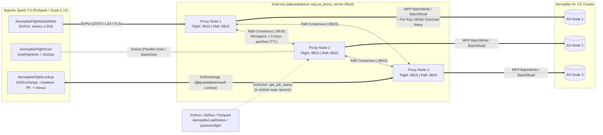

# as-flight-proxy: Spark → Arrow Flight → Rust MPP Proxy → Aerospike 8+ CE

> 🌐 **Язык / Language**: **[🇷🇺 Русский (README.ru.md)](README.ru.md)** | **[🇬🇧 English (README.md)](README.md)**

[](https://github.com/1orgar/as-flight-proxy/actions/workflows/ci.yml)
[-85.6%25-brightgreen?logo=rust)](https://github.com/1orgar/as-flight-proxy/actions/workflows/ci.yml)
[-91.9%25-brightgreen?logo=scala)](https://github.com/1orgar/as-flight-proxy/actions/workflows/ci.yml)
[](https://github.com/1orgar/as-flight-proxy/releases)
[](https://www.rust-lang.org/)
[](https://spark.apache.org/)
[](https://www.scala-lang.org/)
[](https://arrow.apache.org/)
[](https://aerospike.com/)

Высокопроизводительная распределённая система для массово-параллельной **записи (MPP Write)**, **чтения (Parallel Scan / Batch Get)**, **обогащения по ключам (`DoExchange` Lookup)** и **валидации качества данных (Data Quality / DQ)** между **Apache Spark 3.5 (Scala 2.12 / PySpark)** и **Aerospike 8+ Community Edition** через кластер равноправных прокси-нод на **Rust** по протоколу **Apache Arrow Flight (gRPC / HTTP2 + TLS + нативное ZSTD/LZ4 сжатие)** с репликацией метадаты через встроенный **Raft**.

---

## 📚 Подробная документация

В папке [`docs/ru/`](docs/ru/) (и на английском в [`docs/en/`](docs/en/)) доступна полная документация с разбором архитектуры, всех параметров и примерами кода:

| Раздел документации (RU) | English Version (EN) | Описание |
| :--- | :--- | :--- |
| **[1. Архитектура и внутреннее устройство](docs/ru/architecture.md)** | **[Architecture & Internals](docs/en/architecture.md)** | Протокол Arrow Flight (`DoPut`, `DoGet`, `DoExchange`, `GetSchema`, `DoAction`), двухуровневое сжатие (`ZSTD` / `LZ4` / `GZIP`), горячий путь zero-copy, маппинг типов, Raft и политика ретраев. |
| **[2. Конфигурация `proxy_server`](docs/ru/proxy-configuration.md)** | **[Proxy Server Configuration](docs/en/proxy-configuration.md)** | Полный справочник `config.toml`, аргументов CLI, переменных окружения, настройки TLS/mTLS, пулов соединений Aerospike и тюнинга Linux. |
| **[3. Справочник `spark_connector` и примеры](docs/ru/spark-connector.md)** | **[Spark Connector Guide & Examples](docs/en/spark-connector.md)** | Все опции `.format("aerospike-flight")`, `AerospikeFlightLookup` (Scala + PySpark), `AerospikeLoadStatus`, примеры для записи, DQ, чтения и Python `pyarrow.flight`. |
| **[4. Прямые вызовы Flight из Python](docs/ru/flight-operations.md)** | **[Direct Flight Operations (Python)](docs/en/flight-operations.md)** | Как напрямую из Python (`pyarrow.flight`) проверять статус Raft и джобов, сбрасывать мету, вычитывать данные в `pyarrow.Table` / `pandas`, делать `DoExchange` Lookup и `DoPut`. |
| **[5. Мониторинг, логи и траблшутинг](docs/ru/observability.md)** | **[Observability, Metrics & Logging](docs/en/observability.md)** | Справочник из 26 метрик Prometheus, готовые PromQL-запросы, примеры логов Driver / Executor и решение типовых проблем. |

---

## Оглавление

1. [Архитектура и схема работы](#1-архитектура-и-схема-работы)
2. [Маппинг типов данных, семантика `NULL` и `NaN`](#2-маппинг-типов-данных-семантика-null-и-nan)
3. [Режимы работы: запись, DQ, чтение и `DoExchange` Lookup](#3-режимы-работы-запись-dq-чтение-и-doexchange-lookup)
4. [Сжатие Arrow Flight и оптимизации производительности](#4-сжатие-arrow-flight-и-оптимизации-производительности)
5. [Конфигурация `proxy_server` (Rust)](#5-конфигурация-proxy_server-rust)
6. [Опции `spark_connector` (Spark 3.5 / PySpark / Scala)](#6-опции-spark_connector-spark-35--pyspark--scala)
7. [Примеры использования (PySpark, Scala, `pyarrow.flight`)](#7-примеры-использования-pyspark-scala-pyarrowflight)
8. [Мониторинг и метрики Prometheus](#8-мониторинг-и-метрики-prometheus)
9. [Сборка, тесты и CI/CD артефакты (`.zip` и Fat-JAR)](#9-сборка-тесты-и-cicd-артефакты-zip-и-fat-jar)

---

## 1. Архитектура и схема работы



### Ключевые особенности архитектуры:
* **Четыре полноценных режима работы**:
  1. **MPP Запись (`DoPut`)**: параллельная выгрузка DataFrame в Aerospike (`update`, `replace`, `update_only`, `replace_only`, `create_only`).
  2. **DQ-валидация (`DoPut` + `validateOnly`)**: побиновая сверка DataFrame с записями в Aerospike через `BatchRead` с поддержкой `NaN == NaN -> true` и сохранением примеров расхождений в Raft.
  3. **Параллельное чтение (`GetSchema` + `GetFlightInfo` + `DoGet`)**: чтение по списку ключей (`aerospike.read.keys`) или параллельное сканирование с `Filter Pushdown` и `Column Pruning`.
  4. **Стриминговое обогащение по ключам (`DoExchange` Lookup)**: передача миллионов первичных ключей из существующего DataFrame в прокси и получение нужных бинов обратно без выгрузки всего сета и без передачи гигантских списков ключей через `SparkConf`.
* **Равноправные ноды с Raft-консенсусом на отдельном порту (`:8816`)**:
  * Все прокси-серверы абсолютно симметричны для клиентов Spark.
  * Каждая нода публикует прогресс обработки батчей (`RecordJobBatch`) в Raft. Статус джоба доступен на любой ноде в течение `raft.job_stats_ttl_secs`.

---

## 2. Маппинг типов данных, семантика `NULL` и `NaN`

| Тип Spark SQL | Тип Apache Arrow | Тип Aerospike (`aerospike::Value`) | Примечание |
| :--- | :--- | :--- | :--- |
| `BooleanType` | `Boolean` | `Value::Bool(bool)` | |
| `ByteType`, `ShortType`, `IntegerType`, `LongType` | `Int8`, `Int16`, `Int32`, `Int64` | `Value::Int(i64)` | Расширяется до 64-битного целого со знаком |
| `FloatType`, `DoubleType` | `Float32`, `Float64` | `Value::Float(FloatValue)` | IEEE-754 64-bit float; в режиме DQ `NaN == NaN` считается **`true`** |
| `DecimalType(p, s)` | `Decimal128(p, s)` | `Value::String(String)` | Строковое представление с точным сохранением масштаба (`"123.45"`) |
| `StringType` | `Utf8` / `LargeUtf8` | `Value::String(String)` | UTF-8 строка |
| `BinaryType` | `Binary` / `LargeBinary` | `Value::Blob(Vec<u8>)` | Массив байт |
| `DateType` | `Date32` (days) | `Value::Int(i64)` | **UTC миллисекунды** (`days * 86_400_000`) |
| `TimestampType` | `Timestamp(Microsecond, "UTC")` | `Value::Int(i64)` | **UTC миллисекунды** (`micros / 1_000`) |
| `ArrayType(elemType)` | `List(elemField)` | `Value::List(Vec<Value>)` | Рекурсивная конвертация в Aerospike CDT List |
| `MapType(kType, vType)` | `Map(entries)` | `Value::OrderedMap(IndexMap)` | Рекурсивная конвертация в Aerospike CDT Map |
| `StructType(fields)` | `Struct(fields)` | `Value::OrderedMap(IndexMap)` | Вложенный документ (`field_name -> Value`) |

---

## 3. Режимы работы: запись, DQ, чтение и `DoExchange` Lookup

* **Запись (`df.write.format("aerospike-flight")`)**: поддерживает режимы `update`, `replace`, `update_only`, `replace_only`, `create_only`. При `aerospike.ignoreNulls = false` (по умолчанию) `NULL` в режиме `update` удаляет соответствующий бин в Aerospike (`Value::Nil`).
* **DQ-валидация (`aerospike.dq = true`)**: сверяет данные в Spark с Aerospike через `BatchRead`. Корректно сравнивает `NaN == NaN` (в том числе внутри `Array`/`Map`/`Struct`) и сохраняет отчёт в Raft (`dq_passed`, `total_missing_keys`, `total_bin_mismatch_rows`, `dq_mismatch_samples`).
* **Параллельное чтение (`spark.read.format("aerospike-flight")`)**: поддерживает автоматический вывод схемы (`GetSchema`), проталкивание предикатов (`EqualTo`, `In`, числовые диапазоны) и проекцию колонок (`RequiredColumns`) до уровня `BatchRead` Aerospike.
* **Обогащение по ключам (`AerospikeFlightLookup.enrich` / `aerospike.lookup.sourceView`)**: двунаправленный стрим `DoExchange` отправляет из каждой партиции Spark только колонку первичного ключа и возвращает запрошенные бины (`left` или `inner` join).

---

## 4. Сжатие Arrow Flight и оптимизации производительности

Система включает полный стек оптимизаций горячего пути и настраиваемую (отключаемую) компрессию сетевого трафика:

1. **Двухуровневое сжатие (`zstd`, `lz4`, `gzip`, `none`)**:
   * **На уровне буферов Arrow IPC (`ZSTD` / `LZ4_FRAME`)**: нативное сжатие off-heap буферов колонок через JNI (`com.github.luben.zstd.Zstd.compressUnsafe` / `decompressUnsafe`) в `spark_connector` и `arrow-ipc` в `proxy_server`.
   * **На уровне gRPC-конвертов (`zstd`, `gzip`)**: сжатие HTTP/2 фреймов в Tonic и Netty gRPC.
   * **Полное отключение компрессии**: задайте `flight.compression.enabled = false` (или `flight.compression = none`) на клиенте или `compression_enabled = false` в `config.toml` прокси-сервера.
2. **Оптимизации горячего пути и адаптивное батчевание на лету (включая широкие таблицы до `300+` бинов в `0.4.4`)**:
   * В `spark_connector`: специализированные небоксированные функции записи примитивов (`RowColumnWriter`), прямой перенос `UTF8String` в `VarCharVector` без промежуточного `byte[]` (`getBaseObject`), сохранение выученной ёмкости буферов при `reset()` и конвейерная отправка `DoPut` со скользящим окном (`maxInFlightBatches = 2`).
   * В `proxy_server`: адаптивная эвристика батчевания на лету и упреждающее предотвращение `wait` кластера Aerospike (`AdaptiveBatchTuner` с учётом геометрии строки, BBR/Vegas-детектора раздувания очередей, fair-share параллелизма стримов и поиска максимума RPS по градиенту `goodput`), удержание буферов сокетов Aerospike до `256 КБ` (`buffer_reclaim_threshold = 262144`), однократная валидация схемы на весь `RecordBatch` с заимствованными ссылками `&str` на имена бинов, коалесцирование обновлений статуса в Raft (`propose_batch` + компактификация лога `InstallSnapshot`) и `Release`-профиль с `lto = "thin"`, `codegen-units = 1`, `opt-level = 3`.

### Оптимальные сочетания параметров (`spark_connector` + `proxy.toml`) по сценариям

> 📖 Подробный разбор формул расчёта и тюнинга см. в **[Руководстве по настройке `proxy_server` (Раздел 5)](docs/ru/proxy-configuration.md#5-рекомендации-по-тюнингу-производительности-и-оптимальные-сочетания-параметров-proxytoml--spark_connector)**.

| Сценарий нагрузки | Параметры `spark_connector` | Параметры `proxy.toml` |
| :--- | :--- | :--- |
| **Узкие таблицы (`1–20` бинов)** | `connector.batchSize = "8192"`<br>`connector.writerThreads = "2"`..`"4"`<br>`flight.compression = "zstd"`, `level = "1"` | `writer.batch_write_size = 512..1024`<br>`writer.max_in_flight_records = 16384`<br>`writer.max_concurrent_subbatches_per_stream = 16` |
| **Широкие таблицы (`50–150` бинов, например `100` `Float`)** | `connector.batchSize = "2048"`..`"4096"`<br>`connector.writerThreads = "2"`<br>`flight.compression = "zstd"`, `level = "1"` | `writer.batch_write_size = 512`<br>`writer.max_in_flight_records = 32768`<br>`writer.max_concurrent_subbatches_per_stream = 8`<br>`aerospike.conn_pools_per_node = 8` |
| **Сверхширокие таблицы (`150–300+` бинов) или тяжёлые CDT** | `connector.batchSize = "1024"`..`"2048"`<br>`connector.writerThreads = "1"`..`"2"`<br>`flight.compression = "zstd"`, `level = "1"`..`"3"` | `server.max_decoding_message_size_mb = 128`<br>`writer.batch_write_size = 256..512`<br>`writer.max_in_flight_records = 32768`<br>`writer.max_concurrent_subbatches_per_stream = 6..8` |
| **Высокий параллелизм Spark (`160+` ядер) + малые поды (`1 vCPU / 2 Гб`)** | `connector.batchSize = "2048"`<br>`connector.writerThreads = "1"`..`"2"`<br>`flight.compression = "zstd"` (или `"lz4"`) | `writer.batch_write_size = 512`<br>`writer.max_in_flight_records = 16384`<br>`writer.max_concurrent_subbatches_per_stream = 4..8` |
| **Параллельное чтение (`DoGet`) и `DoExchange` Lookup** | `aerospike.read.numPartitions = "160"`..`"320"`<br>`aerospike.read.batchSize = "4096"` + `.select(...)` | `server.compression = "zstd"`, `compression_level = 1`<br>`writer.batch_write_size = 512` |

---

## 5. Конфигурация `proxy_server` (Rust)

> 📖 Полное описание всех параметров см. в **[Руководстве по настройке `proxy_server`](docs/ru/proxy-configuration.md)**.

Пример конфигурационного файла ([`proxy_server/config.example.toml`](proxy_server/config.example.toml)):

```toml
[server]
listen_addr = "0.0.0.0:8815"                  # Порт Arrow Flight gRPC сервера
metrics_addr = "0.0.0.0:9090"                 # Порт HTTP сервера для /metrics и /healthz
max_decoding_message_size_mb = 64
tcp_nodelay = true
http2_stream_window_size_mb = 16
http2_connection_window_size_mb = 32
compression_enabled = true                    # Мастер-переключатель компрессии Flight (false = отключить)
compression = "zstd"                          # Алгоритм по умолчанию: "zstd", "lz4", "gzip" или "none"
compression_level = 1                         # Уровень сжатия ZSTD по умолчанию: 1..9 (или -7..22, дефолт 1)

[raft]
enabled = true
node_id = 1
listen_addr = "0.0.0.0:8816"                  # Отдельный порт для обмена метадатой по Raft
election_timeout_min_ms = 150
election_timeout_max_ms = 300
heartbeat_interval_ms = 50
job_stats_ttl_secs = 3600
max_log_entries = 4096

[tls]
enabled = false

[auth]
enabled = true
username = "spark_writer"
password = "change_me_in_prod"
token_secret = "super_secret_hmac_key_for_flight_bearer_tokens"
token_ttl_secs = 86400

[aerospike]
hosts = "127.0.0.1:3000"
connect_timeout_ms = 5000
timeout_ms = 2000
min_conns_per_node = 16
max_conns_per_node = 512
conn_pools_per_node = 4
max_bin_name_len = 64

[writer]
use_batch_write = true
batch_write_size = 512
max_in_flight_records = 16384
max_concurrent_subbatches_per_stream = 16
adaptive_batching = true
min_batch_write_size = 16
max_batch_write_size = 2048
target_write_latency_ms = 15
target_batch_bytes = 262144

[retry]
max_other_retries = 5
initial_backoff_ms = 10
max_backoff_ms = 2000
backoff_multiplier = 2.0
```

---

## 6. Опции `spark_connector` (Spark 3.5 / PySpark / Scala)

> 📖 Подробный разбор всех опций и паттернов использования см. в **[Справочнике по коннектору Apache Spark](docs/ru/spark-connector.md)**.

Формат источника данных: `.format("aerospike-flight")`.

| Опция | Обязательна | По умолчанию | Описание |
| :--- | :---: | :---: | :--- |
| `aerospike.namespace` | **Да** | — | Namespace в Aerospike |
| `aerospike.keyColumn` | **Да** | — | Имя колонки DataFrame, содержащей первичный ключ |
| `aerospike.set` | Нет | `""` | Имя Set в Aerospike |
| `aerospike.writeMode` | Нет | `"update"` | Режим: `"update"`, `"replace"`, `"update_only"`, `"replace_only"`, `"create_only"`, `"validate"` (`"dq"`) |
| `aerospike.dq` | Нет | `"false"` | Если `"true"` — включает режим проверки записи (DQ-валидации) |
| `aerospike.ignoreNulls` | Нет | `"false"` | По умолчанию `false` (`null` в `update` удаляет бин в Aerospike). Если `true` — `null`-колонки игнорируются |
| `aerospike.ttl` | Нет | Namespace default | TTL записи в секундах (`-1` = Never expire, `-2` = Do not update TTL) |
| `aerospike.sendKey` | Нет | `"true"` | Сохранять ли исходное значение пользовательского ключа на сервере Aerospike |
| `aerospike.useBatchWrite` | Нет | Настройка прокси | Принудительно включить (`true`) или отключить (`false`) `BatchWrite` для данного джоба |
| `flight.hosts` | Нет | `"127.0.0.1:8815"` | Список адресов прокси-нод через запятую (`"proxy1:8815,proxy2:8815,proxy3:8815"`) |
| `flight.username` | Нет | `""` | Логин для Arrow Flight `Handshake` |
| `flight.password` | Нет | `""` | Пароль для Arrow Flight `Handshake` |
| `flight.tls.enabled` | Нет | `"false"` | Включить TLS при подключении к прокси |
| `flight.tls.caCertPath` | Нет | Системный truststore | Путь к PEM-файлу корневого сертификата CA на узлах Spark |
| `flight.tls.clientCertPath` | Нет | — | Путь к клиентскому сертификату (PEM) для mTLS |
| `flight.tls.clientKeyPath` | Нет | — | Путь к приватному ключу клиента (PKCS#8 PEM) для mTLS |
| `flight.tls.verifyServer` | Нет | `"true"` | Проверять ли сертификат сервера при TLS |
| `flight.timeoutMs` | Нет | `"60000"` | Таймаут RPC вызовов Arrow Flight (мс) |
| `flight.compression` | Нет | `"zstd"` | Сжатие Arrow Flight стримов (`"zstd"`, `"zstd:3"`, `"lz4"`, `"gzip"`, `"none"` / `"off"`) |
| `flight.compression.level` | Нет | `"1"` | Уровень сжатия ZSTD (`1..9` основной диапазон, `-7..22` полный диапазон ZSTD; `1` — самый быстрый) |
| `flight.compression.enabled` | Нет | `"true"` | Мастер-переключатель компрессии на клиенте (`"false"` отключает сжатие) |
| `aerospike.read.numPartitions` | Нет | `"32"` | Число партиций Spark при параллельном чтении (`1..4096`) |
| `aerospike.read.batchSize` | Нет | `"4096"` | Число строк в одном `RecordBatch` при чтении (`DoGet`) и `DoExchange` Lookup |
| `aerospike.read.sampleSize` | Нет | `"1000"` | Число записей для автоматического `inferSchema` через `GetSchema` |
| `aerospike.read.typeMismatchMode` | Нет | `"fail"` | Поведение при несовпадении типа бина со схемой: `"fail"` или `"null"` |
| `aerospike.read.keys` | Нет | — | Список PK (CSV или JSON-массив) для прямого `BatchGet` чтения |
| `aerospike.lookup.sourceView` | Нет | — | Имя временного View с ключами для распределённого `DoExchange` обогащения |
| `aerospike.lookup.joinType` | Нет | `"left"` | Тип обогащения при `DoExchange` Lookup: `"left"` или `"inner"` |
| `connector.jobId` | **Да** | — | Уникальный идентификатор джобы в Raft (при повторном запуске с тем же `jobId` мета в Raft автоматически перезатирается) |
| `connector.batchSize` | Нет | `"8192"` | Число строк в одном Arrow `RecordBatch` на запись |
| `connector.writerThreads` | Нет | `"4"` | Число параллельных потоков отправки Arrow Flight внутри каждой Spark-задачи |
| `connector.queueCapacity` | Нет | `writerThreads * 2` | Размер очереди подготовленных `RecordBatch` внутри задачи |
| `connector.autoConvertStrings` | Нет | `"false"` | Автоконвертация строковых колонок при записи (`"1" -> Int`, `"1.0" -> Double`, иначе `String`) |

---

## 7. Примеры использования (PySpark, Scala, `pyarrow.flight`)

### 7.1. Параллельная запись DataFrame из PySpark в Aerospike
```python
job_id = "user-features-load-2026-11-10"

(
    df.repartition(64, "user_id")
    .write.format("aerospike-flight")
    .option("connector.jobId", job_id)
    .option("flight.hosts", "proxy-1:8815,proxy-2:8815,proxy-3:8815")
    .option("flight.username", "spark_writer")
    .option("flight.password", "change_me_in_prod")
    .option("flight.compression", "zstd")         # "zstd", "lz4", "gzip" или "none"
    .option("flight.compression.enabled", "true")
    .option("aerospike.namespace", "prod_ns")
    .option("aerospike.set", "user_features")
    .option("aerospike.keyColumn", "user_id")
    .option("aerospike.writeMode", "update")
    .option("aerospike.ignoreNulls", "false")
    .option("aerospike.ttl", "86400")
    .mode("append")
    .save()
)
```

### 7.2. Обогащение DataFrame по первичным ключам через `DoExchange` Lookup (PySpark)
Позволяет взять существующий DataFrame с миллионами первичных ключей и дочитать для них только нужные бины из Aerospike напрямую внутри партиций без Shuffle:

```python
from pyspark.sql import DataFrame
from pyspark.sql.types import StructType, StructField, StringType, DoubleType, LongType


def aerospike_lookup(
    keys_df: DataFrame,
    options: dict[str, str],
    bins_schema: StructType,
    join_type: str = "left",
) -> DataFrame:
    spark = keys_df.sparkSession
    jvm = spark._jvm
    jmap = jvm.PythonUtils.toScalaMap(options)
    jschema = jvm.org.apache.spark.sql.types.DataType.fromJson(bins_schema.json())
    jdf = jvm.com.asproxy.spark.AerospikeFlightLookup.enrich(
        keys_df._jdf, jmap, jschema, join_type
    )
    return DataFrame(jdf, spark)


bins_to_fetch = StructType([
    StructField("score", DoubleType(), nullable=True),
    StructField("segment", StringType(), nullable=True),
    StructField("updated_at", LongType(), nullable=True),
])

enriched_df = aerospike_lookup(
    keys_df=events_df,
    options={
        "flight.hosts": "proxy-1:8815,proxy-2:8815,proxy-3:8815",
        "flight.username": "spark_writer",
        "flight.password": "change_me_in_prod",
        "flight.compression": "zstd",
        "aerospike.namespace": "prod_ns",
        "aerospike.set": "user_features",
        "aerospike.keyColumn": "user_id",
        "aerospike.read.batchSize": "4096",
    },
    bins_schema=bins_to_fetch,
    join_type="left",
)
```

*(Также поддерживается чистый DataSource V2 вариант через `aerospike.lookup.sourceView` без вызова JVM-бриджа — см. [docs/ru/spark-connector.md](docs/ru/spark-connector.md#5-обогащение-dataframe-по-ключам-через-doexchange-lookup)).*

### 7.3. Параллельное чтение с Filter Pushdown и Column Pruning
```python
df = (
    spark.read.format("aerospike-flight")
    .option("flight.hosts", "proxy-1:8815,proxy-2:8815,proxy-3:8815")
    .option("flight.username", "spark_writer")
    .option("flight.password", "change_me_in_prod")
    .option("aerospike.namespace", "prod_ns")
    .option("aerospike.set", "user_features")
    .option("aerospike.keyColumn", "user_id")
    .option("aerospike.read.numPartitions", "32")
    .load()
    .filter("user_id IN ('u-100', 'u-200', 'u-300') AND score >= 0.85")
    .select("user_id", "score", "segment")
)
```

---

## 8. Мониторинг и метрики Prometheus

> 📖 Полный справочник по всем 26 метрикам, PromQL-запросам и логам см. в **[Мониторинге и наблюдаемости](docs/ru/observability.md)**.

На порту `server.metrics_addr` (по умолчанию `:9090`) доступны:
* `GET /healthz` — проверка связности прокси с кластером Aerospike (`200 OK` / `503 Service Unavailable`).
* `GET /metrics` — 26 метрик Prometheus, охватывающих запись (`DoPut`), адаптивный тюнер батчевания (`AdaptiveBatchTuner`), чтение (`DoGet`), `DoExchange` Lookup, DQ-валидацию, ретраи перегрузки, пулы и состояние Raft.

---

## 9. Сборка, тесты и CI/CD артефакты (`.zip` и Fat-JAR)

### Локальная сборка, запуск тестов и проверка покрытия (>= 85%)
```bash
# Rust Proxy Server (покрытие cargo-llvm-cov >= 85%)
cd proxy_server
cargo llvm-cov --all-targets --summary-only --fail-under-lines 85
cargo build --release

# Spark Connector (Scala 2.12 / Spark 3.5, покрытие sbt-scoverage >= 85%)
cd ../spark_connector
sbt clean coverage test coverageReport
sbt "set ThisBuild / coverageEnabled := false" assembly
```

### GitHub Actions CI и релизные артефакты
При каждом пуше в `main` и создании тега `v*` workflow [`.github/workflows/ci.yml`](.github/workflows/ci.yml) автоматически проверяет покрытие (`>= 85%`) и публикует 3 релизных артефакта:
1. `as_proxy_server-linux-x86_64.zip` — ZIP-архив с бинарником `as_proxy_server` для Linux `x86_64` и примером конфигурации `config.example.toml`.
2. `as_proxy_server-linux-arm64.zip` — ZIP-архив с бинарником `as_proxy_server` для Linux `ARM64` (`aarch64`) и `config.example.toml`.
3. `spark-aerospike-flight-connector-assembly-0.4.4.jar` — Fat-JAR коннектора для Spark 3.5 (Scala 2.12).

### Запуск полного E2E-стенда (Docker Compose)
```bash
mkdir -p e2e/artifacts
ARCH=$(uname -m | sed 's/aarch64/arm64/')
curl -sL "https://github.com/1orgar/as-flight-proxy/releases/latest/download/as_proxy_server-linux-${ARCH}.zip" -o e2e/artifacts/proxy.zip
unzip -o e2e/artifacts/proxy.zip -d e2e/artifacts/
mv "e2e/artifacts/as_proxy_server-linux-${ARCH}" e2e/artifacts/as_proxy_server
chmod +x e2e/artifacts/as_proxy_server
curl -sL "https://github.com/1orgar/as-flight-proxy/releases/latest/download/spark-aerospike-flight-connector-assembly-0.4.4.jar" -o e2e/artifacts/spark-aerospike-flight-connector-assembly-0.4.4.jar

docker compose -f docker-compose.e2e.yml up --abort-on-container-exit --exit-code-from spark-e2e
docker compose -f docker-compose.e2e.yml down
```
