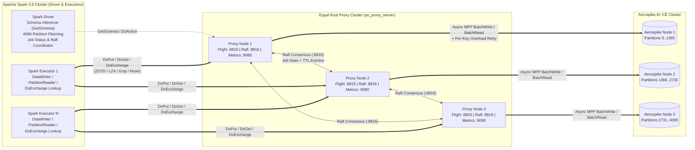

# Architecture & Internals (`as-flight-proxy`)

🇬🇧 **English** | [🇷🇺 Русская версия](../ru/architecture.md) | [⬅ Back to README](../../README.md)

---

## Table of Contents

1. [System Overview](#1-system-overview)
2. [End-to-End Data Flows](#2-end-to-end-data-flows)
3. [Arrow Flight Protocol Specification](#3-arrow-flight-protocol-specification)
4. [Arrow Flight Compression & Zero-Copy Pipeline](#4-arrow-flight-compression--zero-copy-pipeline)
5. [MPP Execution Engine, Retries & Backpressure](#5-mpp-execution-engine-retries--backpressure)
6. [Raft Consensus & Distributed Job Tracking](#6-raft-consensus--distributed-job-tracking)
7. [Hot-Path Performance Optimizations](#7-hot-path-performance-optimizations)

---

## 1. System Overview

`as-flight-proxy` is a massively parallel processing (MPP) bridge between **Apache Spark 3.5 (Scala 2.12 / PySpark)** and **Aerospike 8+ Community Edition**. Instead of opening thousands of direct Aerospike client connections from ephemeral Spark executors or serializing rows one-by-one, Spark executors stream columnar **Apache Arrow** batches over **Arrow Flight (gRPC / HTTP2 + TLS)** to a symmetric cluster of stateless/Raft-coordinated **Rust proxy servers (`as_proxy_server`)**.

---

## 2. End-to-End Data Flows

### 2.1. Parallel Write & Data Quality (DQ) Validation (`DoPut`)
1. **Driver Validation (ФЛК)**: Before launching a Spark job, `AerospikeSchemaValidator` validates the `DataFrame` schema on the Driver (checking primary key existence and type, bin count `1..32767`, bin name length `<= 15` UTF-8 bytes, printable ASCII characters `0x21..0x7E`, and recursive CDT types).
2. **Executor Columnar Batching**: Each Spark task creates an `AerospikeFlightDataWriter` with an off-heap Arrow `VectorSchemaRoot` (`batchSize`, default `8192` rows) and a pool of `writerThreads` (default `4`).
3. **Multi-Stream `DoPut`**: Worker threads pull `ArrowRecordBatch`es from a bounded `ArrayBlockingQueue` (`queueCapacity`), apply off-heap `ZSTD` or `LZ4_FRAME` compression, and stream them to round-robin selected proxy endpoints (`endpointFor(partitionId, threadIdx)`).
4. **Proxy MPP Execution**: `as_proxy_server` decodes each `RecordBatch`, converts rows into `PreparedRecord`s without extra allocations, splits them into sub-batches (`batch_write_size`, default `512`), and executes concurrent `Client::batch` (`BatchWrite` for writes or `BatchRead` for DQ validation) bounded by the global `max_in_flight_records` semaphore.
5. **Per-Batch Ack & Raft Replication**: After each batch is persisted/validated in Aerospike, the proxy sends a JSON `PutBatchAck` back to the Spark executor over the `DoPut` response stream and replicates the batch counters into the Raft cluster.
6. **Job Completion**: When all tasks commit, the Spark Driver sends `DoAction("complete_job")` (or `"fail_job"` on abort) to the proxy and logs the final `LoadJobSummary`.

### 2.2. Parallel Scan & BatchGet Read (`GetSchema` + `DoGet`)
1. **Optional Schema Inference**: If the user does not supply `.schema(...)`, `AerospikeFlightSchemaInferrer` sends `GetSchema` to the proxy. The proxy samples up to `sample_size` records from Aerospike, merges bin types into an Arrow `Schema`, and returns it to Spark.
2. **Column Pruning & Filter Pushdown**:
   * `SupportsPushDownRequiredColumns` prunes unreferenced Aerospike bins so only required bins are fetched over the network.
   * `SupportsPushDownFilters` inspects Spark Catalyst predicates on `aerospike.keyColumn` (`=`, `<=>`, `IN`, `AND`, `OR`). If PK predicates or `aerospike.read.keys` are present, the scan switches from a 4096-partition scan to a direct **`BatchKeys`** read!
3. **Partition Planning**:
   * **Full Scan**: Splits Aerospike's `4096` partitions evenly across `aerospike.read.numPartitions` Spark tasks (`PartitionRange { begin_partition, partition_count }`).
   * **BatchKeys**: Splits the target keys across Spark tasks.
4. **Executor `DoGet` Streaming**: Each task opens a `DoGet` stream with a JSON `ReadTicket`, decompresses incoming Arrow batches (`ZSTD` / `LZ4_FRAME` / `Gzip`), and converts vectors into Catalyst `InternalRow`s via pre-compiled column readers.

### 2.3. Distributed DataFrame Key Lookup Enrichment (`DoExchange`)
1. Given any existing Spark `DataFrame` containing primary keys (`keysDf`), `AerospikeFlightLookup.lookup` plans a partition-preserving transformation (`mapPartitionsWithIndex`) **without shuffling or collecting keys to the Driver**.
2. Each Spark executor opens a bidirectional Arrow Flight `DoExchange` stream to a proxy node:
   * A background sender thread converts input `InternalRow`s into Arrow batches and streams them to the proxy.
   * The proxy extracts the primary keys from each incoming batch, executes parallel MPP `BatchRead` lookups in Aerospike for the requested bins, and immediately streams back enriched Arrow batches (`input columns + looked-up bin columns`) preserving row order (`left` or `inner` join).

---

## 3. Arrow Flight Protocol Specification

| Flight RPC | Direction | Descriptor / Payload | Purpose |
| :--- | :--- | :--- | :--- |
| `Handshake` | Client ↔ Proxy | Protobuf `BasicAuth { username, password }` | Authenticates credentials and returns `authorization: Bearer <HMAC-SHA256-token>` header |
| `DoPut` | Executor → Proxy | `FlightDescriptor.cmd` = JSON `WriteParameters` | Streams Arrow `RecordBatch`es for write (`update`, `replace`, etc.) or DQ validation (`validate`); returns `PutBatchAck` per batch |
| `GetSchema` | Driver → Proxy | `FlightDescriptor.cmd` = JSON `InferSchemaRequest` | Samples up to `sample_size` records in Aerospike and returns inferred Arrow `Schema` |
| `DoGet` | Executor ← Proxy | `Ticket` = JSON `ReadTicket` (`PartitionRange` or `BatchKeys`) | Streams Arrow `RecordBatch`es for partition range scans or multi-key `BatchGet` |
| `DoExchange` | Executor ↔ Proxy | `FlightDescriptor.cmd` = JSON `LookupExchangeParams` | Bidirectional stream: executor sends input DataFrame batches, proxy returns batches enriched with Aerospike bins |
| `DoAction` | Driver/Client → Proxy | `get_job_status`, `complete_job`, `fail_job`, `get_cluster_status` | Queries or updates Raft-replicated job statistics and cluster topology |

---

## 4. Arrow Flight Compression & Zero-Copy Pipeline

`as-flight-proxy` supports configurable and disableable compression at two layers:

1. **Arrow IPC Buffer Compression (`zstd` [default], `lz4`)**:
   * Compresses each Arrow vector buffer (`validity`, `offsets`, `values`) inside `RecordBatch` IPC messages using `CompressionType::ZSTD` or `CompressionType::LZ4_FRAME`.
   * On the Scala/Spark side (`ArrowCompressionCodecs.scala`), `ZstdArrowCodec` uses `com.github.luben.zstd.Zstd.compressUnsafe` and `decompressUnsafe` directly against off-heap `ArrowBuf.memoryAddress()` pointers — **zero heap byte array copies**.
   * Outbound streams enable `listener.setUseZeroCopy(true)` so Netty/gRPC reads directly from Arrow off-heap memory.
2. **gRPC Transport Compression (`gzip`)**:
   * Compresses the entire HTTP/2 gRPC frame stream using `gzip`.
3. **Disabling Compression (`none`)**:
   * Set `.option("flight.compression", "none")` or `.option("flight.compression.enabled", "false")` on Spark, or `compression_enabled = false` / `compression = "none"` in `proxy.toml`.

---

## 5. MPP Execution Engine, Retries & Backpressure

When `as_proxy_server` writes or reads a sub-batch in Aerospike (`src/writer.rs`):

1. **Global In-Flight Semaphore**:
   * Before dispatching a sub-batch of $N$ records, the engine acquires $N$ permits from `in_flight_semaphore` (`writer.max_in_flight_records`, default `16384`).
   * If Aerospike slows down, permit acquisition naturally applies backpressure to the Arrow Flight gRPC stream, pausing Spark executor senders without dropping records or exhausting memory.
2. **Two-Tier Retry Policy**:
   * **Tier 1 — Infinite Overload Retries ("до талого")**:
     * Triggered by `ResultCode::DeviceOverload`, `ResultCode::KeyBusy`, `ResultCode::XdrKeyBusy`, client `NoMoreConnections` (`NO_AVAILABLE_CONNECTIONS_TO_NODE`), `MaxRetriesExceeded`, `ConnectionPoolEmpty`, or `AsyncQueueFull`.
     * Retried **indefinitely** using exponential backoff with full jitter (`initial_backoff_ms` up to `max_backoff_ms`).
   * **Tier 2 — Bounded Non-Overload Retries**:
     * Triggered by any other transient error (e.g., network timeout, socket reset).
     * Retried up to `retry.max_other_retries` times (default `5`). If still failing, the stream aborts with `tonic::Code::Aborted` and fails the Spark task.
3. **Zero-Clone Partial Sub-Batch Retry**:
   * On the first attempt, `&pending_records` is passed directly to Aerospike with **zero `Key`/`Bin` clones**.
   * If 500 out of 512 keys succeed and 12 fail with `KEY_BUSY`, successful records are swapped out in-place and only the 12 failed records remain in `pending_records` for the next retry iteration.

---

## 6. Raft Consensus & Distributed Job Tracking

* Each `as_proxy_server` node runs an embedded Raft state machine (`src/raft.rs`) on a dedicated TCP port (`raft.listen_addr`, default `:8816`) separate from the Arrow Flight data plane (`:8815`).
* During `DoPut` streaming, `PutBatchAck` is returned to the Spark executor **immediately** after `write_record_batch` completes, while `MetadataCommand::RecordJobBatch` updates are coalesced per stream and committed via `raft.propose_batch(...)` when the stream completes (or every 64 batches) without global cross-stream mutex serialization:
  * If the node is the **Raft Leader**, it appends the batch of entries under a single lock acquisition and replicates it concurrently to followers.
  * If the node is a **Follower**, it forwards the batch of commands to the current Leader over TCP without blocking other concurrent streams.
* Job statistics (`JobLoadStatus`) are retained in memory for `raft.job_stats_ttl_secs` (default `3600` seconds) and automatically evicted by a background compaction task.

---

## 7. Hot-Path Performance Optimizations

* **Rust Release Profile (`proxy_server/Cargo.toml`)**: Built with `opt-level = 3`, `lto = "thin"`, `codegen-units = 1`, `strip = true`.
* **Aerospike Socket Buffer Retention (`buffer_reclaim_threshold = 256 KB` in `main.rs`)**: Raises `ClientPolicy::buffer_reclaim_threshold` from the `64 KB` default to `256 KB` (`262,144` bytes), eliminating repeated `128 KB` `TieredBufferPool` zeroing (`memset(0)`) and `1 KB` heap shrink cycles on wide-table `BatchOperate` payloads (`100–300+` bins).
* **Single-Pass Schema Validation & Borrowed Bin Names (`converter.rs` & `writer.rs`)**: Validates the Arrow `RecordBatch` schema once (`validate_record_batch_schema`) before slicing into `RecordBatch::slice` sub-batches, and borrows `&str` column names directly from the Arrow `Schema` inside `CompiledBinColumn` without per-slice `String` or `HashSet` allocations.
* **On-the-Fly Adaptive Batching & Proactive Cluster-Wait Avoidance (`AdaptiveBatchTuner` in `writer.rs`)**: A lock-free hot-path closed-loop controller combines row geometry (`num_bins`, `approx_row_bytes`, `target_batch_bytes = 256 KB`), BBR/Vegas queue-inflation detection (`queue_inflation = ema_unit_latency / min_unit_latency > 1.55`), global fair-share concurrency across active streams, and goodput-gradient hill-climbing — proactively throttling and applying micro-pacing **before** Aerospike enters `wait` or emits `DEVICE_OVERLOAD`.
* **Raft Log Compaction (`InstallSnapshot`) & HMAC Frame Authentication (`raft.rs`)**: Automatically compacts committed Raft log prefixes exceeding `raft.max_log_entries` into an in-memory snapshot (catching up lagging followers via `InstallSnapshot`) and authenticates inter-node Raft RPC frames with constant-time `HMAC-SHA256` when `raft.cluster_secret` is configured.
* **Unboxed Primitive Writers & Zero-Copy `UTF8String` Transfer (`ArrowBatchConverter.scala`)**: Uses specialized `RowColumnWriter` traits to write primitive columns without JVM boxing, preserves `VarCharVector` learned buffer capacity across `reset()`, and copies `UTF8String` bytes directly from `getBaseObject` without allocating intermediate `byte[]` arrays via `utf8.getBytes`.
* **Sliding-Window `DoPut` Stream Pipelining (`AerospikeFlightDataWriter.scala`)**: Keeps up to `maxInFlightBatches = 2` batches in flight per `DoPut` stream, overlapping network RTT with serialization of the next batch.
