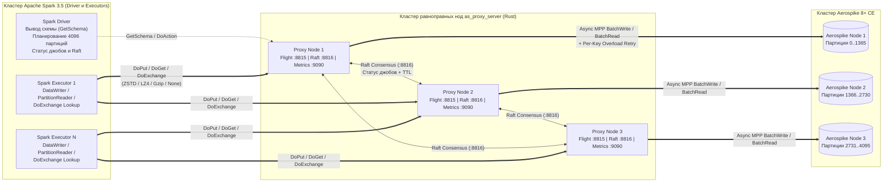

# Архитектура и внутреннее устройство (`as-flight-proxy`)

[🇬🇧 English version](../en/architecture.md) | 🇷🇺 **Русский** | [⬅ Назад к README](../../README.ru.md)

---

## Оглавление

1. [Обзор системы](#1-обзор-системы)
2. [Сквозные потоки данных (Data Flows)](#2-сквозные-потоки-данных-data-flows)
3. [Спецификация протокола Arrow Flight](#3-спецификация-протокола-arrow-flight)
4. [Компрессия Arrow Flight и Zero-Copy конвейер](#4-компрессия-arrow-flight-и-zero-copy-конвейер)
5. [MPP-движок, политика ретраев и Backpressure](#5-mpp-движок-политика-ретраев-и-backpressure)
6. [Raft-консенсус и распределённый трекинг джобов](#6-raft-консенсус-и-распределённый-трекинг-джобов)
7. [Оптимизации производительности на горячем пути (Hot Path)](#7-оптимизации-производительности-на-горячем-пути-hot-path)

---

## 1. Обзор системы

`as-flight-proxy` — это высокопроизводительная распределённая MPP-система для записи, параллельного чтения, обогащения по ключам (Lookup) и валидации качества данных (DQ) между **Apache Spark 3.5 (Scala 2.12 / PySpark)** и **Aerospike 8+ Community Edition**.

Вместо открытия тысяч прямых соединений с экзекьюторов Spark к узлам Aerospike и построчной сериализации, экзекьюторы Spark передают колоночные батчи **Apache Arrow** по протоколу **Arrow Flight (gRPC / HTTP2 + TLS)** на симметричный кластер равноправных прокси-нод на **Rust (`as_proxy_server`)**, координирующих метаданные и статистику джобов через встроенный **Raft**.

---

## 2. Сквозные потоки данных (Data Flows)

### 2.1. Параллельная запись и DQ-валидация (`DoPut`)
1. **ФЛК на Драйвере (`AerospikeSchemaValidator`)**: до старта задач Spark проверяет схему `DataFrame` (наличие и тип первичного ключа, количество бинов `1..32767`, длину имён бинов `<= 15` байт UTF-8, печатные ASCII-символы `0x21..0x7E`, допустимость вложенных типов `Array`, `Map`, `Struct`).
2. **Колоночная буферизация на Экзекьюторе**: каждая Spark-задача создаёт `AerospikeFlightDataWriter` с off-heap буфером `VectorSchemaRoot` (`batchSize`, по умолчанию `8192` строки) и пулом из `writerThreads` (по умолчанию `4`) потоков отправки.
3. **Многопоточный `DoPut`**: рабочие потоки забирают готовые `ArrowRecordBatch` из ограниченной очереди `ArrayBlockingQueue` (`queueCapacity`), сжимают буферы через off-heap `ZSTD` или `LZ4_FRAME` и параллельно стримят их на прокси-ноды (`endpointFor(partitionId, threadIdx)`).
4. **MPP-исполнение на Прокси**: `as_proxy_server` декодирует `RecordBatch`, конвертирует строки в `PreparedRecord` без лишних аллокаций, разрезает пачку на под-батчи (`batch_write_size`, по умолчанию `512`) и асинхронно выполняет `Client::batch` (`BatchWrite` для записи или `BatchRead` для DQ-сверки) под защитой глобального семафора `max_in_flight_records`.
5. **Подтверждение батча и репликация в Raft**: после записи каждого батча прокси возвращает JSON `PutBatchAck` в стрим `DoPut` и публикует статистику батча в Raft.
6. **Завершение джоба**: после коммита всех партиций Драйвер отправляет `DoAction("complete_job")` (или `"fail_job"` при ошибке) и формирует итоговый `LoadJobSummary`.

### 2.2. Параллельное чтение: Scan и BatchGet (`GetSchema` + `DoGet`)
1. **Автоматический вывод схемы (`inferSchema`)**: если пользователь не передал `.schema(...)`, `AerospikeFlightSchemaInferrer` вызывает `GetSchema`. Прокси семплирует до `sample_size` записей из Aerospike, объединяет типы бинов в схему Arrow и возвращает её на Драйвер.
2. **Column Pruning и Filter Pushdown**:
   * `SupportsPushDownRequiredColumns` отсекает неиспользуемые колонки — из Aerospike запрашиваются только реально нужные бины.
   * `SupportsPushDownFilters` анализирует фильтры Spark по колонке первичного ключа (`=`, `<=>`, `IN`, `AND`, `OR`). Если задан фильтр по PK или опция `aerospike.read.keys`, вместо полного скана автоматически используется прямое пакетное чтение **`BatchKeys`**!
3. **Планирование партиций**:
   * **Полный скан (`PartitionRange`)**: делит `4096` партиций Aerospike поровну между `aerospike.read.numPartitions` задачами Spark.
   * **Чтение по ключам (`BatchKeys`)**: распределяет список ключей по партициям Spark.
4. **Чтение стрима `DoGet`**: экзекьюторы открывают `DoGet` с JSON-тикетом `ReadTicket`, прозрачно распаковывают сжатые батчи (`ZSTD` / `LZ4_FRAME` / `Gzip`) и конвертируют векторы в `InternalRow` через предкомпилированные функции чтения колонок.

### 2.3. Распределённое обогащение DataFrame по ключам (`DoExchange`)
1. При вызове `AerospikeFlightLookup.lookup(keysDf, binsSchema, options)` коннектор строит `RDD.mapPartitionsWithIndex` **без шаффла и без сбора ключей на Драйвер**.
2. Внутри каждой партиции открывается двунаправленный стрим Arrow Flight `DoExchange`:
   * Фоновый поток экзекьютора упаковывает входные строки `keysDf` в батчи Arrow и отправляет их на прокси.
   * Прокси извлекает первичные ключи из каждого батча, выполняет параллельный `BatchRead` нужных бинов из Aerospike, доклеивает колонки бинов к исходному батчу (`left` или `inner` join) и тут же стримит обогащённый батч обратно экзекьютору.

---

## 3. Спецификация протокола Arrow Flight

| Flight RPC | Направление | Дескриптор / Полезная нагрузка | Назначение |
| :--- | :--- | :--- | :--- |
| `Handshake` | Клиент ↔ Прокси | Protobuf `BasicAuth { username, password }` | Проверка учётных данных и выдача заголовка `authorization: Bearer <HMAC-SHA256-токен>` |
| `DoPut` | Экзекьютор → Прокси | `FlightDescriptor.cmd` = JSON `WriteParameters` | Стриминг `RecordBatch` на запись (`update`, `replace` и др.) или DQ-проверку (`validate`); возвращает `PutBatchAck` на каждый батч |
| `GetSchema` | Драйвер → Прокси | `FlightDescriptor.cmd` = JSON `InferSchemaRequest` | Семплирование до `sample_size` записей в Aerospike и возврат выведенной схемы Arrow |
| `DoGet` | Экзекьютор ← Прокси | `Ticket` = JSON `ReadTicket` (`PartitionRange` или `BatchKeys`) | Стриминг `RecordBatch` при сканировании диапазона партиций или пакетном чтении ключей |
| `DoExchange` | Экзекьютор ↔ Прокси | `FlightDescriptor.cmd` = JSON `LookupExchangeParams` | Двунаправленный стрим: экзекьютор шлёт батчи входного DataFrame, прокси возвращает обогащённые бинами батчи |
| `DoAction` | Драйвер/Клиент → Прокси | `get_job_status`, `complete_job`, `fail_job`, `get_cluster_status` | Запрос и обновление реплицируемой в Raft статистики джобов и состояния кластера |

---

## 4. Компрессия Arrow Flight и Zero-Copy конвейер

Система поддерживает настраиваемую и отключаемую компрессию на двух уровнях:

1. **Сжатие буферов Arrow IPC (`zstd` [по умолчанию], `lz4`)**:
   * Сжимает буферы колонок (`validity`, `offsets`, `values`) внутри сообщений `RecordBatch` алгоритмами `CompressionType::ZSTD` или `CompressionType::LZ4_FRAME`.
   * На стороне Spark (`ArrowCompressionCodecs.scala`) кодек `ZstdArrowCodec` вызывает нативные методы `com.github.luben.zstd.Zstd.compressUnsafe` и `decompressUnsafe` напрямую по off-heap адресам `ArrowBuf.memoryAddress()` — **без копирования массивов байт в кучу JVM**.
   * Для исходящих потоков включается `listener.setUseZeroCopy(true)`, чтобы gRPC/Netty читал буферы напрямую из off-heap памяти Arrow.
2. **Транспортное сжатие gRPC (`gzip`)**:
   * Сжимает HTTP/2 gRPC-фреймы целиком алгоритмом `gzip`.
3. **Полное отключение компрессии (`none`)**:
   * На клиенте Spark: `.option("flight.compression", "none")` или `.option("flight.compression.enabled", "false")`.
   * На сервере `proxy_server`: `compression_enabled = false` или `compression = "none"` в секции `[server]` файла `proxy.toml`.

---

## 5. MPP-движок, политика ретраев и Backpressure

При выполнении записи или чтения в `as_proxy_server` (`src/writer.rs`):

1. **Глобальный семафор `max_in_flight_records`**:
   * Перед отправкой под-батча из $N$ записей движок запрашивает $N$ разрешений у семафора (`writer.max_in_flight_records`, по умолчанию `16384`).
   * При замедлении Aerospike семафор автоматически создаёт обратное давление (backpressure) на gRPC-стрим Arrow Flight, притормаживая потоки отправки на экзекьюторах Spark без потери данных и без переполнения памяти.
2. **Двухуровневая политика ретраев**:
   * **Уровень 1 — Бесконечные ретраи перегрузки («до талого»)**:
     * Срабатывают при `DEVICE_OVERLOAD`, `KEY_BUSY`, `XDR_KEY_BUSY`, `NO_AVAILABLE_CONNECTIONS_TO_NODE` (`NoMoreConnections`), `MAX_RETRIES_EXCEEDED`, `ConnectionPoolEmpty`, `AsyncQueueFull`.
     * Повторяются **бесконечно** с экспоненциальным backoff и полным джиттером (`initial_backoff_ms` → `max_backoff_ms`).
   * **Уровень 2 — Ограниченные ретраи прочих ошибок**:
     * Срабатывают при любых других ошибках (таймаут сети, разрыв сокета и т.д.).
     * Повторяются до `retry.max_other_retries` раз (по умолчанию `5`), после чего стрим завершается с `Status::aborted`.
3. **Zero-Clone частичный ретрай пачки (`Partial Sub-Batch Retry`)**:
   * На первой попытке срез `&pending_records` передаётся в Aerospike **без клонирования `Key`/`Bin`**.
   * Если из 512 ключей 500 записались успешно, а 12 вернули `KEY_BUSY`, успешные элементы удаляются за $O(1)$ через `swap_remove`, и на повторную отправку уходят только 12 оставшихся ключей.

---

## 6. Raft-консенсус и распределённый трекинг джобов

* Каждая нода `as_proxy_server` поднимает легковесный Raft-узел (`src/raft.rs`) на отдельном TCP-порту (`raft.listen_addr`, по умолчанию `:8816`), изолированном от трафика Arrow Flight (`:8815`).
* Во время стриминга `DoPut` подтверждение `PutBatchAck` отправляется экзекьютору Spark **мгновенно** после записи батча в Aerospike, а команды `MetadataCommand::RecordJobBatch` коалесцируются внутри стрима и отправляются пакетным вызовом `raft.propose_batch(...)` при завершении стрима (или каждые 64 батча) без глобальных сериализующих блокировок между потоками:
  * Если нода является **Leader-ом**, она за один захват `RwLock` применяет пачку записей и параллельно реплицирует её на Follower-ов.
  * Если нода является **Follower-ом**, она пересылает пачку команд текущему Leader-у по TCP без блокировки других параллельных стримов.
* Статистика джобов (`JobLoadStatus`) хранится в памяти в течение `raft.job_stats_ttl_secs` (по умолчанию `3600` секунд) и автоматически очищается фоновым процессом.

---

## 7. Оптимизации производительности на горячем пути (Hot Path)

* **Релизный профиль Rust (`proxy_server/Cargo.toml`)**: сборка с `opt-level = 3`, `lto = "thin"`, `codegen-units = 1`, `strip = true`.
* **Удержание буферов сокетов Aerospike (`buffer_reclaim_threshold = 256 КБ` в `main.rs`)**: порог возврата буфера в `ClientPolicy` увеличен со стандартных `64 КБ` до `256 КБ` (`262 144` байт), что устраняет постоянные переаллокации (`memset(0)` на 128 КБ в `TieredBufferPool` при отправке и сжатие до 1 КБ при чтении 22-байтного ответа) на широких таблицах (`100–300+` бинов).
* **Однократная валидация схемы и заимствование имён бинов (`converter.rs` и `writer.rs`)**: проверка схемы `validate_record_batch_schema` выполняется **один раз** на весь входящий `RecordBatch` до его нарезки на под-батчи `RecordBatch::slice`, а `CompiledBinColumn` хранит заимствованные ссылки `&str` на имена колонок из схемы Arrow без клонирования `String` и `HashSet` на каждый под-батч.
* **Адаптивная эвристика батчевания на лету и защита от `wait` кластера (`AdaptiveBatchTuner` в `writer.rs`)**: замкнутый контроллер комбинирует геометрию строки (`num_bins`, `approx_row_bytes`, `target_batch_bytes = 256 КБ`), детектор раздувания очередей BBR/Vegas (`queue_inflation = ema_unit_latency / min_unit_latency > 1.55`), справедливое деление глобального бюджета параллелизма между активными стримами и поиск максимума RPS по градиенту `goodput`, упреждающе снижая нагрузку и включая micro-pacing ещё **до** появления `DEVICE_OVERLOAD`.
* **Компактификация лога Raft (`InstallSnapshot`) и HMAC-аутентификация (`raft.rs`)**: при превышении `raft.max_log_entries` закоммиченный префикс лога сворачивается в компактный in-memory снэпшот, автоматически догоняющий отставшие ноды через `InstallSnapshot`, а при задании `raft.cluster_secret` все внутренние RPC-фреймы подписываются и верифицируются через `HMAC-SHA256`.
* **Небоксированная запись примитивов и прямой перенос `UTF8String` (`ArrowBatchConverter.scala`)**: специализированный интерфейс `RowColumnWriter` записывает `Int`/`Long`/`Float`/`Double`/`Boolean` без боксинга в `java.lang.Object`, переиспользует выученную ёмкость `VarCharVector` через `root.allocateNew()` и копирует `UTF8String` напрямую из `getBaseObject` (`byte[]`) без промежуточного вызова `utf8.getBytes`.
* **Конвейерная отправка `DoPut` со скользящим окном (`AerospikeFlightDataWriter.scala`)**: каждый поток отправки держит до `maxInFlightBatches = 2` батчей в полёте по HTTP/2 стриму, перекрывая сетевой RTT сериализацией следующего батча.
